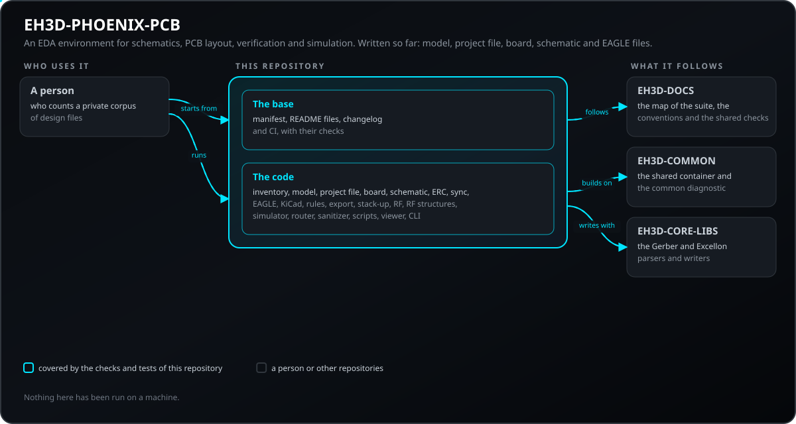
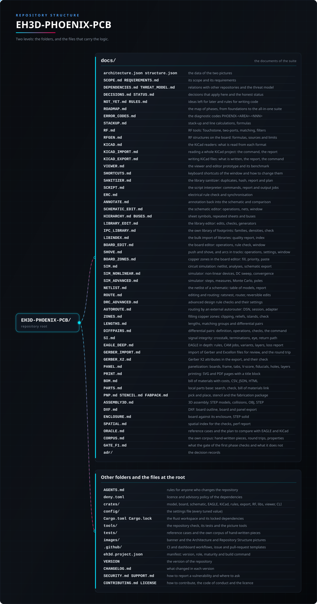

<p align="center">
  
</p>

#  EH3D-PHOENIX-PCB
<p align="center"><a href="README.md">🇺🇸 English</a> | <a href="README_spa.md">🇪🇸 Español</a> | <a href="README_fra.md">🇫🇷 Français</a> | <a href="README_ita.md">🇮🇹 Italiano</a> | <a href="README_deu.md">🇩🇪 Deutsch</a> | <a href="README_zho.md">🇨🇳 中文</a> | 🇯🇵 <b>日本語</b> | <a href="README_por.md">🇵🇹 Português</a></p>

### EH3D-PHOENIX-PCB：回路図入力、PCB レイアウト、検証ツール、回路シミュレーション、スイッチング電源と RF 向けの専用モジュールを備えた EDA 環境として計画中。現時点で書かれているのはコーパスの棚卸しだけです。

<p align="center">
  
  
  
  
  
  
</p>

---

**正直さの確認 - 今日実際に動くもの：** コマンド `phoenix inventory` を持つ Rust ワークスペースで、非公開フォルダー内の設計ファイルを、名前や値を一切表示せずに数えます（拡張子・種類・宣言されたバージョンごとのファイル数と、内容の指紋 1 つ）。独自のテストが 3946 件あり、コンピューター上で通っています。実行したのは自身のテストが作ったフォルダーだけで、実際の設計ファイルでは一度もありません。設計モデルの土台（範囲を検査するナノメートルとマイクロ度の整数値、オブジェクト ID、正規化 JSON）、プロジェクトファイル `.phoenixproj`（マニフェスト、ドメイン、移行）、元に戻せる操作を持つ基板モデル（層、ネット、部品、配線、ビア、ゾーン）もありますが、生成したデータでしか試していません。基板ライブラリは、どの銅がどの銅に接しているかの判定と、ルールファイルに基づくサイズと間隔の検査も行います。5 つ目のライブラリは EAGLE XML のライブラリ・基板・回路図を要約として読み、XML ツリーを同一のまま書き戻します。すべて生成または手作りのファイルでしか試していません。回路図モデルと基板との整合性検査もあります。他の設計のモデルへの取り込みとエディターはなく、ルールも予定した検査の一部しかカバーしておらず、EDA の機能の大半は計画段階のままです。基板モデルには、ルールチェックと Gerber 出力が使うシルク文字とシルク線（内蔵のストロークフォント）も含まれます。回路図はシートに配置した部品と配線で描くことができ、ネットリストおよび基板と照合されます。基板は EAGLE の XML ファイルとして書き出して読み戻せますが、確認したのはこのコードが書いたファイルだけで、EAGLE で開いたことはありません。EAGLE のバイナリファイルとその XML の組を扱う取り決めは書かれていますが、バイナリファイルの読み取り部はありません。 スタックアップと伝送線路の計算機能（`phoenix stackup`：公表された式によるマイクロストリップ、ストリップライン、コプレーナ導波路、結合ペアのインピーダンス、実効誘電率、損失、遅延、配線幅）は試作段階で、電磁界シミュレータや実測との比較はまだありません。EH3D-COMMON の材料データベース（`phoenix materials`、`phoenix stackup --material ID`）を使うと、層の Dk と Df はデータシートが公表した点から取られ、外挿は行われません。これらの値を基板の実測と比較したことはありません。規則と接続性のライブラリ（`eh3d-phoenix-rules`）は、制限値をルールファイルまたは EAGLE 基板のデザインルールから読み取り、基板を決まった順序（幅、ビア、ドリル、リング、間隔、基板端、ドリル間隔、ソルダーマスク、ゾーン、シルク）で検査し、短絡や未配線のネットを見つけ、基板のネットを回路図のネットと比べます。コマンド `phoenix check` と `phoenix connectivity` は、確定した結果と判定できなかった結果を分けて報告を出力します。確認したのは手作業で作った基板だけで、基準となるツールと比べたことはありません。 さらに設計ルールの検査（`phoenix check --advanced`：アニュラリング、基板端までの距離、アシッドトラップ、電圧に応じた間隔、銅箔の島、行き止まりの配線、重複ビア、ネットのないパッド、外形の外の部品。制限値とレベルは `config/drc_advanced.cfg`）もプロトタイプで、手作業で作った基板でしか試しておらず、製造業者のルールや他のツールと比べたことはありません。間隔表の数値は規格で確認していません。 製造向けエクスポート（`phoenix export`）は、各層の Gerber X2 ファイル、メッキありとメッキなしの Excellon ドリルファイル、実装座標ファイルと部品表を、JSON ファイルから読み込んだプロファイルで出力し、SHA-256 の一覧（マニフェスト）と、ファイルを読み戻して基板と照合する検査を備えます。さらに `phoenix pnp`、`phoenix stencil`、`phoenix fabpack` が、実装座標ファイル、はんだペーストステンシルの開口部、マニフェスト付きの決定論的な zip パッケージを出力します。いずれもプロトタイプで、機械に読み込ませたことも、ステンシルにしたことも、製造業者に送ったこともありません。これは試作段階で、ファイルはこのリポジトリのパーサーで読み戻しただけであり、独立したビューアや製造業者で開いたことはありません。RF ツール群（`eh3d-phoenix-rf`、コマンド `phoenix rf`）は、Touchstone ファイルの読み書き、S・Z・Y・ABCD パラメータの変換、VSWR・損失・群遅延・安定性の計算、複素インピーダンスに対する L 型回路・シングルスタブ・1/4 波長変成器の設計、スミスチャートの座標、理想部品によるバターワース・チェビシェフ・ベッセルのラダー型フィルタの設計を行います。これは試作段階で、教科書の値でのみ確認しており、ネットワークアナライザ、電磁界シミュレータ、他の RF プログラムとの比較はまだありません。KiCad リーダー（`eh3d-phoenix-kicad`、コマンド `phoenix kicad-read`）は、KiCad 6 から 9 のシンボルライブラリ、フットプリント、シートを含む回路図、基板、プロジェクトファイルを EAGLE ファイルと同じモデルに読み込み、取り込みレポートと忠実度レベルを出します。これは試作段階で、テスト用に手で書いたファイルでのみ試しており、KiCad との比較や公開された設計集での実行はまだありません。 ライブラリ整理ツール（`eh3d-phoenix-sanitizer`、コマンド `phoenix sanitize`）は、古い EAGLE ライブラリのフォルダーを読み、重複またはほぼ重複するフットプリント、シンボル、デバイスセットを、正規化した幾何ハッシュ、しきい値に対するスコア、HTML と JSON のレポート、マスターライブラリの計画とともに報告します。分析するだけで、ライブラリを書き換えることも計画を適用することもありません。これは試作段階で、自身のテストが作ったライブラリでのみ試しており、実際のライブラリでの実行はまだありません。電気的ルールチェック（`eh3d-phoenix-erc`、コマンド `phoenix erc`）は回路図を判定します：ネットに接続されていないピン、ピンが1本だけのネット、設定ファイルの行列が同時に許さないピンの種類、ドライバのない入力、電源のない電源入力、紛らわしいネット名、重複したリファレンス、空の値、フットプリントのない部品、孤立した配線、何も駆動しないネット、近くにデカップリングコンデンサのないチップの電源ピン、打ち間違いかもしれないネット名、何にも触れていないラベル。確定した結果と判定できなかった結果は別に示します。同期（`eh3d-phoenix-sync`、コマンド `phoenix sync`）は、部品の同一性で回路図と基板を比較し、基板への転送または回路図への逆アノテーションの変更を、先にドライランで確かめ、元に戻して再実行できるパッケージとして行います。逆アノテーションは、各変更に状態（適用可、競合、無視）を付け確認コードを要する計画（`phoenix annotate`）としても出せ、2つの文書の比較（`phoenix sync --diff`）もあります。第2形式のルールファイルは、配線とビアに独自の制限を持つネットクラスも保持します。いずれも試作段階で、手で作った回路図と基板およびテストが作ったものでのみ試しており、基準ツールとの比較はなく、回路図エディタ（コマンド `phoenix schedit` とウィンドウの編集モード）も試作段階で、画面なしでのみ試しています。元に戻せる操作、図面に追従するネットリスト、変更のたびのルール検査、基板への転送を備えます。回路シミュレータ（`eh3d-phoenix-sim`、コマンド `phoenix sim`）は、SPICE 形式のネットリストの読み書き、回路図からネットリストへの変換、独自の修正節点解析による線形回路、ダイオード回路（直列抵抗、接合容量、降伏を含む）、バイポーラおよび MOS トランジスタ、電圧制御スイッチ、オペアンプのマクロモデルの解法（DC 動作点と 1 つの電源の DC 掃引、群遅延付きの AC 掃引、雑音解析、電源の折れ点で止まる刻みの過渡解析）を行い、RF ツールのラダーフィルタとの照合も備え、ネットリストの `.op`・`.dc`・`.tran`・`.ac` 行と同じフォルダのファイルの `.include` も読みます。教科書の値と閉形式の解でテストした試作段階のもので、SPICE や測定との比較は行っておらず、素子モデルは単純です。 さらに、値のリストに対する繰り返し実行、結果からの測定、固定シードによる公差のモンテカルロ、AC 応答のフィッティングによる雑音・極・零点も備えます。これも試作段階で、閉形式の解を持つ例で確認しただけで、SPICE とは比較していません。 編集と配線のロジックのクレート（`eh3d-phoenix-route`、コマンド `phoenix route` と `phoenix ratsnest`）は、まだ配線されていない接続を一覧にし、ネットの 2 つの要素の間を 0・45・90 度の線分で配線します。障害物の手前で止まるか迂回するかを選べ、幅はネットクラスから、ビアはルールから決まります。編集は元に戻せる操作で、ルール検査に何が加わるかを報告します。手で作った基板とテストで作った基板でのみ試した試作段階のもので、円弧と銅箔ゾーンはなく、これを使って編集するウィンドウ（`phoenix view`）は一度も画面で見ていません。 外部オートルーターによる配線はファイル経由で行います（`phoenix autoroute`）。基板を Specctra DSN ファイルとして書き出し、Specctra セッションは、配線をルールで検査して全部適用するか全く適用しないかの計画として読み込みます。プログラムを起動するアダプターは既定でオフで、設定ファイルのスイッチとコマンドラインのオプションの両方がなければ何も起動しません。手作りのセッションでしか試しておらず、実際のオートルーターでは一度も試していない試作段階のものです。 自前の簡単なオートルーター（`phoenix autoroute native`）は、未接続の接続を、グリッド上の層ごとの探索で、ビア付きで、ノード数で数える上限の範囲内の引き剥がし再配線を使って配線します。その計画はルールで検査され、ルール違反を追加することはありません。手作りの小さな基板とテストで試しただけの試作段階のもので、ウィンドウのボタンは一度も画面で見ていません。 スクリプトインタープリタ（`eh3d-phoenix-script`、コマンド `phoenix script run`、`phoenix script report`、`phoenix cam-import`）は、以前のワークフローのコマンド言語のスクリプトファイルを読み、`WIRE`、`VIA`、`MOVE`、`CHANGE`、`DELETE`、`DRC` など同等のものがあるコマンドを基板の元に戻せる操作として、全部か無かで、元をバイト単位で取り戻せる取り消し付きで実行し、すべてのスクリプトのすべてのコマンドを、同等・調整済み・保留のいずれかとその原因付きで一覧にし、出力ジョブをエクスポートプロファイルとして読み込みます。言語の公開されている説明から作られた試作段階のもので、テスト用に書いたスクリプトでのみ試しており、元のツールとの比較や作者自身のスクリプトでの実行は行っていません。 第2のスクリプト言語（`phoenix-script/2`：変数、回数に上限のあるループ、検索、基板・回路図・ライブラリを元に戻せる1つのステップとして変更する編集を、上限付きのサンドボックス内で行う。`phoenix script check`、`list`、`help`）は試作段階で、手で作った文書でのみ試しています。 RF構造ジェネレータ（`eh3d-phoenix-rfgen`、コマンド `phoenix rfgen`）は、スタックアップと周波数から、マイクロストリップ線路、面取りした曲がりと円弧の曲がり、幅の遷移、スタブ、整合回路、インピーダンス段差の低域通過フィルタと結合線路の帯域通過フィルタ、ウィルキンソン分配器、ブランチライン結合器、パッチアンテナとダイポールアンテナ、ビアフェンス付きの SMA 接続部を、公表されている式で描き、基板の元に戻せる操作として全部か無かで基板に置き、寸法・使用した式・結果のルール検査を記したレポートを付けます。試作段階のもので、教科書の値とテストが作る基板でのみ試しており、電磁界シミュレータや測定との比較は行っていません。KiCad ライター（コマンド `phoenix kicad-export`）は、基板、回路図、フットプリント、シンボルを KiCad 8 のファイルとして書き出し、モデルで表せなかった内容のレポートを付けます。試作段階で、書き出したファイルを KiCad で開いたことはありません。差動ペア（コマンド `phoenix pairs` と、`phoenix boardedit` の操作 `route_pair`、`tune_pair`、`fix_pair_gap`）は、ペアの 2 本の配線を並べて引き、蛇行で長さを揃え、間隔を修正し、間隔、対称性、結合していない区間、長さ、ビア、幅、そしてスタックアップがあればインピーダンスを検査します。手作業とテストで作った基板でのみ試した試作段階で、ウィンドウのペアツールを画面で見たことはありません。押しのけ配線（`phoenix boardedit` の操作 `route_shove`）は、新しい配線が詰め寄る他のネットの配線を、ファイルで決めた深さと本数の範囲で平行にずらします。全部実行するか何もしないかで、規則エラーが残る場合は拒否します。配線の円弧（`route_arc`、`round_corners`）と 45 度の部分への蛇行も加わります。手作業とテストで作った基板でのみ試した試作段階で、ウィンドウの押しのけツールを画面で見たことはありません。 印刷（`phoenix print`、`eh3d-phoenix-print`）は、回路図のシート、基板の実装図とレイヤー、およびパネルを SVG または手書きの PDF として書き出します。PDF は自身のクレートの検査器でしか読まれておらず、実際の PDF ビューアで開かれたことのないプロトタイプです。 シグナルインテグリティの推定（`phoenix si`、`eh3d-phoenix-si`）は、閉じた式とスタックアップから、平行トラック間のクロストーク、ネットの反射と終端、簡略化したアイダイアグラム、トラックのリターン経路を求めます。準静的なプロトタイプで、テストが作った基板でしか試しておらず、フィールドソルバ、シミュレータ、測定とは何も比較していません。 線路断面の二次元電界ソルバー（`phoenix field2d`：インピーダンス、誘電率、インダクタンス、ペアの結合を閉形式の式と並べて表示）、ネットの電流による配線とビアの発熱（`phoenix thermal`）、ゾーン塗りつぶしの丸めた角はプロトタイプで、厳密解と閉形式の式でのみ確認しており、他の電界ソルバーや測定とは比較していません。

---

> **安全性とセキュリティの現状：** このリポジトリは最初の段階で、安全装置ではありません。ここに書かれたことが、機械とそのコントローラーの上限、インターロック、非常停止の代わりになることはありません。

## 📋 ひと目で

| | |
|---|---|
| バージョン | `0.0.5` |
| 成熟度 | 足場 |
| テスト | 3946 |
| 技術スタック | Rust, Python 3.10+ |
| 実機での動作 | まだハードウェアでは実行していません |

**移動先：** [概要](#-概要) · [アーキテクチャ](#-アーキテクチャ) · [クイックスタート](#-クイックスタート) · [テスト](#-テスト) · [リポジトリの構成](#-リポジトリの構成) · [関連プロジェクト](#-関連プロジェクト)

## 🚦 プロジェクトの状況

各行はこのリポジトリの一部分で、信号は今日どこまで進んでいるかを示します。計画ではなく、リポジトリが示せるもの（テスト、ビルド、実行）に基づいて書かれています。

🟢 完了・検証済み · 🟡 動作する（既知の制限あり） · 🟠 一部のみ、または未検証 · 🔴 未実装または動作しない

| 領域 | 状態 | ここでの意味 |
|---|---|---|
| リポジトリ チェック | 🟡 | リポジトリ チェック、画像のチェック、基盤の 45 件のテストは CI で実行され、通っています。 |
| テスト | 🟡 | Rust コードの 3946 件のテストと基盤の 45 件のテストは、コンピューター上で通っています。テスト自身が作ったフォルダーだけを使っており、実際の設計ファイルで実行したものはありません。 |
| 実機 | 🟠 | どの機械やボードでも実行していません。ここにあるものは、ハードウェア上で試していません。 |
| 計画中の機能 | 🟠 | 作成済み：コーパスの伏せ字モードによる棚卸し、モデルの土台（単位、ID、正規化 JSON）、プロジェクトファイル `.phoenixproj`、元に戻す／やり直しを持つ基板モデルとその接続性、最初のルール検査、EAGLE XML の要約リーダー。未着手：KiCad 以外の形式のモデルへの取り込み、他形式の書き出し、ルールの大半、エディターと最終版のビューアー、シミュレータと SPICE の比較、その他の計画内容すべて。基板モデルには、ルールチェックと Gerber 出力が使うシルク文字とシルク線（内蔵のストロークフォント）も含まれます。回路図はシートに配置した部品と配線で描くことができ、ネットリストおよび基板と照合されます。基板は EAGLE の XML ファイルとして書き出して読み戻せますが、確認したのはこのコードが書いたファイルだけで、EAGLE で開いたことはありません。EAGLE のバイナリファイルとその XML の組を扱う取り決めは書かれていますが、バイナリファイルの読み取り部はありません。 スタックアップと伝送線路の計算機能（`phoenix stackup`：公表された式によるマイクロストリップ、ストリップライン、コプレーナ導波路、結合ペアのインピーダンス、実効誘電率、損失、遅延、配線幅）は試作段階で、電磁界シミュレータや実測との比較はまだありません。EH3D-COMMON の材料データベース（`phoenix materials`、`phoenix stackup --material ID`）を使うと、層の Dk と Df はデータシートが公表した点から取られ、外挿は行われません。これらの値を基板の実測と比較したことはありません。RF ツール群（`phoenix rf`：Touchstone ファイル、2 ポートパラメータ、整合、理想ラダー型フィルタ、および推定値としての pi/T 回路、標準値、マスク、安定円）は試作段階で、教科書の値でのみ確認しており、測定とは比較していません。KiCad リーダー（`phoenix kicad-read`：シンボル、フットプリント、シート付き回路図、基板、プロジェクトファイル）は試作段階で、手で書いたファイルでのみ試しています。 ライブラリ整理ツール（`phoenix sanitize`：EAGLE ライブラリのフォルダーの棚卸し、幾何ハッシュ、しきい値付きのあいまい照合、重複グループ、HTML と JSON のレポート、適用されることのないマスターライブラリの計画）は試作段階で、テストが作ったライブラリでのみ試しています。電気的ルールチェック（`phoenix erc`）と、回路図と基板の同期（`phoenix sync`：基板への転送と逆アノテーション。元に戻せるパッケージとして実行）は試作段階で、手で作った回路図と基板でのみ試しています。独自の回路シミュレータ（`phoenix sim`：SPICE 形式のネットリスト、回路図のネットリスト、線形回路およびダイオード回路の DC・AC・過渡解析）は試作段階で、教科書の値でのみ確認しており、SPICE との比較は行っていません。 編集と配線のロジック（`phoenix route`、`phoenix ratsnest`：未配線の接続、0・45・90 度の線分のルーター、ルール検査をその場で行う元に戻せる編集）は試作段階で、手で作った基板とテストで作った基板でのみ試しています。 スクリプトインタープリタ（`phoenix script run`、`phoenix script report`、`phoenix cam-import`：以前のワークフローのコマンド言語のスクリプトを基板の元に戻せる操作として全部か無かで実行し、コマンドごと・スクリプトごとの互換性レポートを出し、出力ジョブをエクスポートプロファイルとして読み込む）は試作段階で、言語の公開されている説明から作られ、テスト用に書いたスクリプトでのみ試しています。 第2のスクリプト言語（`phoenix-script/2`：変数、回数に上限のあるループ、検索、基板・回路図・ライブラリを元に戻せる1つのステップとして変更する編集を、上限付きのサンドボックス内で行う。`phoenix script check`、`list`、`help`）は試作段階で、手で作った文書でのみ試しています。 RF構造ジェネレータ（`phoenix rfgen`：マイクロストリップ線路、曲がり、スタブ、整合回路、フィルタ、ウィルキンソン分配器、ブランチライン結合器、パッチアンテナとダイポールアンテナ、ビアフェンス付きの SMA 接続部を、スタックアップと周波数から基板の元に戻せる操作として描き、式とルール検査のレポートを付ける）は試作段階で、教科書の値でのみ確認しており、電磁界シミュレータや測定とは比較していません。 コスト付きの部品表（`phoenix bom`：値・フットプリント・メーカーごとにまとめた部品、ローカルファイルの数量区分ごとの価格、基板 1 枚あたりとロットあたりのコスト、例示の料金表による基板コストの見積り）と、部品モデルを使った基板の 3D アセンブリ（`phoenix assembly3d`：表からフットプリントごとに選ぶモデル、各 STEP ソリッドを囲むボックス、ボックスで確認する干渉と高さ、簡略化した OBJ・STEP の書き出し）はプロトタイプで、テストが作った基板とファイルでのみ試しています。料金表は例であり見積りではなく、書き出したファイルを開いた CAD プログラムはなく、シーンを描く 3D ウィンドウは画面で一度も確認されていないプロトタイプです。 参照ケース集（`phoenix oracle`）は、公開されている値とその出典・許容差で計算を確認します。EAGLE、KiCad、電磁界ソルバ、測定との比較ではないため、上の状態は一切変わりません。 手書きの小さな基板・回路図・ライブラリ・製造ファイルと、手計算で求めた数値、拒否されるべきファイル、フォーマット間の往復変換、生成した基板に対する性質を収めた独自のコーパス（`phoenix corpus`）はプロトタイプです。メーカーやユーザーのファイルは含まず、EAGLE・KiCad・CAM プログラムとの比較ではありません。 線路断面の二次元電界ソルバー（`phoenix field2d`：インピーダンス、誘電率、インダクタンス、ペアの結合を閉形式の式と並べて表示）、ネットの電流による配線とビアの発熱（`phoenix thermal`）、ゾーン塗りつぶしの丸めた角はプロトタイプで、厳密解と閉形式の式でのみ確認しており、他の電界ソルバーや測定とは比較していません。 |
| ウィンドウ | 🟠 | 基板と回路図のビューア兼エディタ（`phoenix view`、egui、`gui` 機能の背後）は作成済みで、そのロジックはテストされています。基板は元に戻す・やり直しと各編集のルール検出結果付きで編集でき、回路図は検査・基板との同期・編集（配置、移動、回転、反転、削除、コピーと貼り付け、配線、ラベル、電源ポート、バスのラベル。変更のたびにルール検査）ができ、読み込んだファイルに上書き保存されることはありません。ただしウィンドウは一度も画面で見ていません。画面での描画、マウス操作、動作の滑らかさは未確認です。同じウィンドウにはライブラリモードがあり、EAGLE ライブラリのシンボル、フットプリント、デバイスを編集できます（`phoenix libedit`、`phoenix footprint`、`docs/LIBRARY_EDIT.md`）。元に戻す、ライブラリのチェック、フットプリント生成を備えますが、これも画面で見られたことはありません。 基板編集モード（`phoenix boardedit`、`docs/BOARD_EDIT.md`）は、部品の配置、45度の配線とビア、ネットの貼り付け、ミアンダによる長さ調整を行い、各操作は設計ルールで検査されますが、画面で見られたことも、マウスで使われたこともありません。 フォルダー内の Gerber / Excellon ファイル用ウィンドウ（`docs/VIEWER.md`：ファイルごとに1レイヤー、不透明度、測定、基板との比較）と、実装済み基板の3Dウィンドウ（周回するカメラ、クリックで部品を選択、干渉と高さを表示）は試作で、どちらも画面で見られたことも、マウスで使われたこともありません。 プログラム `phoenix`（コマンドラインと同じもの）は、引数なしで起動すると開始画面（ファイルを開く、新規ライブラリ、最近使ったファイル、ファイルのドロップ）でこれを開き、Windows ではコンソールウィンドウは出ません。 ウィンドウの共通部分（検索、測定、レイヤープリセット、履歴の一覧、テーマ、倍率と変更できるキー、ヘルプ、記憶される設定）も試作であり、画面で見たことはありません。 |
| 要件 | 🟠 | 31 件の要件のうち 21 件（伏せ字モード、モデルの土台、元に戻せる操作、プロジェクトファイル、診断コード、解析的な RF 計算機能、接続性とルールの検査、パッケージを含む製造向けエクスポート、基板と回路図のビューア兼エディタ、KiCad リーダーとライター、ライブラリ整理ツール、回路図の検査と同期、回路シミュレータ、配線ロジック、スクリプトインタープリタ）は試作段階、10 件は計画のみで、検証済みのものはありません。 |

## 🎯 概要

* **現在あるもの：** 設計ファイルの非公開コーパスを伏せ字モードで数えるライブラリ（件数、種類、宣言されたバージョン、指紋 1 つだけで、名前や値は決して出さない）を含むワークスペースと、コマンドライン `phoenix inventory`。ファイルの先頭バイトだけを見て、設計内容は読みません。2 つ目のライブラリには設計モデルの土台があります（範囲を検査した整数の長さと角度、オブジェクト ID（UUID v7）、正規化 JSON）。3 つ目のライブラリは EH3D-COMMON の共有コンテナ上で `.phoenixproj` プロジェクトを読み書きします（ドメイン、リンク、移行を持つマニフェスト、理解できないドメインはそのまま保存、`must_understand` の規則）。4 つ目のライブラリは基板モデルを持ちます（層、ネット、フットプリント、部品、直線と円弧の配線、ビア、ゾーンを安定した ID で結び、元に戻せる操作と元に戻す／やり直しの履歴）。すべての失敗に安定したコード `PHOENIX-<領域>-<NNN>` があります。基板ライブラリは各ネットの島も計算し、幅・ドリル・アニュラリング・間隔をミリメートル単位のルールファイルで検査して、確定した結果と判定できなかった結果を分けて示します。5 つ目のライブラリは EAGLE XML のライブラリ・基板・回路図を要約として読み、XML ツリーを同一のまま書き戻し、SHA-256 で確認したコーパスのコピーで読み取り率を測ります（元のファイルは変更しません）。コマンド `phoenix eagle-rate` で実行できます。6 つ目のライブラリは、EH3D-CORE-LIBS と EH3D-COMMON を使って基板の Gerber X2・Excellon・`.eh3dproj` 1.0.0 ファイルを書き出し、同じ基板なら同じバイト列になります。書き出したファイルは同じライブラリのパーサーでしか読み戻していません。7 つ目のライブラリは回路図（安定した ID で結ばれたシンボル、部品、ネット）を持ち、基板と照合します（コンポーネントのない部品、参照記号・値・フットプリント・ネットの違い。コード `PHOENIX-LINK-<NNN>`）。さらに別のライブラリ `eh3d-phoenix-rules` は、銅箔（パッド、配線、ビア、ゾーンを、許容差付きの形状で結合したもの）からネットを導き、回路図のネットと比べ、ルールファイルまたは EAGLE 基板のデザインルールから読み取った制限値に対して、デザインルールを決まった順序で実行します。確定した結果と判定できなかった結果は 2 つのリストに分かれ、コマンド `phoenix check` と `phoenix connectivity` は報告を 8 言語のテキストまたは JSON で出力します。

* **計画中：** EH3D-PHOENIX-PCB は、回路図入力、PCB レイアウト、検証ツール、回路シミュレーション、スイッチング電源と RF 向けの専用モジュールを備えた EDA 環境となることを目指しています。デスクトップ向けのウィンドウ付き Rust プログラム（エンジン クレートのワークスペース、コマンドライン インターフェース、アプリケーション）として計画されており、単独で動作し、計算タスクにはサーバーを利用できます。これらはまだ何も存在しません。

## 🧩 EH3D での役割

EH3D-PHOENIX-PCB は EH3D Fabrication Suite の PHOENIX ファミリーの中心となるプロジェクトで、ファミリーの他のリポジトリはこれを土台にしています。何をするか、まだ何をしないか、要件、他のリポジトリとの関係は `docs/` フォルダーに書かれています。

## 🏛️ アーキテクチャ

<p align="center">
  
</p>

このリポジトリの各部分の関係：誰が使い、何を持ち、何に依存するか。図は `docs/architecture.json` から描かれ、コードと照合されます。

## 🚀 クイックスタート

チェックには Python 3.10 以降、コードには Rust ツールチェーンが必要です。

```bash
cargo build --release
cargo test
cargo run -p eh3d-phoenix-cli -- inventory <folder>
python -I tools/ci_validate.py
python -I tools/make_architecture.py --check
python -I tools/make_structure.py --check --readmes
python -I -m unittest discover -s tools -p "test_*.py"
```

**ダウンロードしてウィンドウを開く。** リリースのアーカイブ（Windows 64 ビットと 32 ビット、Linux、macOS）には 1 つのプログラム `phoenix` が入っています。コマンドラインであり、引数なしで起動するとビューアー兼エディターのウィンドウになります（以前のバージョンの別プログラム `phoenix-gui` はもうありません）。`phoenix`（Windows では `phoenix.exe`）をダブルクリックすると開始画面が開き、基板、回路図、ライブラリを開いたり、最近使ったファイルを選んだり、ウィンドウにファイルをドロップしたりできます。`phoenix <ファイル>` はファイルをすぐに開きます。Windows ではコンソールウィンドウがないため、開かないときはその理由がユーザーの設定フォルダー（Windows では `%APPDATA%\EH3D-PHOENIX-PCB`、他のシステムでは `~/.config/eh3d-phoenix-pcb`）の `last_error.txt` に書かれます。最近使ったファイルの一覧（`recent.cfg`）も同じフォルダーにあり、保持する数は `config/viewer.cfg` で決めます。コマンド（`phoenix check board.brd`）はこれまでどおりコンソールで動作します。Windows ではターミナルがプログラムの終了を待たないため、終了コードが必要なバッチファイルは `start /wait` で起動してください。ウィンドウはプロトタイプで、マウスでは試されていません（上の状況を参照）。ウィンドウ付きのプログラムをビルドするには: `cargo build --release -p eh3d-phoenix-cli --features gui`。 `phoenix --shot FILE.png [--size WxH] [--theme dark|light|contrast] [--window NAME] [--wait N] [--open FILE]` はウィンドウのスクリーンショットを撮って自動的に閉じます（README の画像はこの方法で作られます）。このモードでは設定も最近使ったファイルの一覧も読み書きしません。

## 🧪 テスト

コードには 3946 件のテスト（`cargo test`）、基盤には 45 件のテスト（`python -I -m unittest discover -s tools -p "test_*.py"`）があり、すべてコンピューター上で通っています。CI は、リポジトリ チェック、画像のチェック、基盤のテストに加え、Rust コードについては書式チェック、警告をエラーとする clippy、そしてテストを Linux と Windows で実行します。

## 🏗️ ビルドとリリース

バージョンは `VERSION` ファイルと `eh3d.project.json` にあり、各バージョンには [CHANGELOG.md](CHANGELOG.md) の項目があります。`cargo build --release` でライブラリと `phoenix` プログラムをビルドし、リリースは GitHub で公開されます。 リリースのアーカイブには、コマンドラインとウィンドウを 1 つにした `phoenix` が入っています。`cargo build --release -p eh3d-phoenix-cli --features gui` でウィンドウ付きをビルドします。

## 📂 リポジトリの構成

<p align="center">
  
</p>

<details>
<summary>ツリーのテキスト版</summary>

```text
EH3D-PHOENIX-PCB/
├── docs/
│   ├── architecture.json structure.json         2 つの図のデータ
│   ├── SCOPE.md REQUIREMENTS.md                 範囲と要件
│   ├── DEPENDENCIES.md THREAT_MODEL.md          他のリポジトリとの関係と脅威モデル
│   ├── SECURITY_REVIEW.md                       セキュリティレビューと有効な上限
│   ├── DECISIONS.md STATUS.md                   適用される決定事項と正直な状況
│   ├── NOT_YET.md RULES.md                      後回しにしたアイデアとコードの記述規則
│   ├── TESTING.md I18N_AUDIT.md                 テストの方法と、8 言語の検査
│   ├── ROADMAP.md                               基盤からオールインワン スイートまでのフェーズ マップ
│   ├── GLOSSARY.md MIGRATION.md                 用語集と、EAGLE／KiCad から移行する人向けのガイド
│   ├── tutorials/ glossary/ migration/          テストが実行するチュートリアル、機能ガイド、翻訳
│   ├── ERROR_CODES.md                           診断コード PHOENIX-<領域>-<NNN>
│   ├── STACKUP.md                               スタックアップと線路の計算、式
│   ├── RF.md                                    RF ツール：Touchstone、2 ポート、整合、フィルタ
│   ├── RF_ADVANCED.md                           RF 拡張：pi/T、標準値、マスク、安定性
│   ├── RFGEN.md                                 基板上のRF構造：式、出典、限界
│   ├── KICAD.md                                 KiCad リーダー：各形式から読み取る内容
│   ├── KICAD_IMPORT.md                          KiCad プロジェクト全体の読み込み：コマンドとレポート
│   ├── KICAD_EXPORT.md                          KiCad ファイルの書き出し：書き出す内容、レポート、コマンド
│   ├── VIEWER.md                                ビューア兼エディタの試作とそのベンチマーク
│   ├── SHORTCUTS.md                             ウィンドウのキーボードショートカットと変更方法
│   ├── SANITIZER.md                             ライブラリ整理：重複、ハッシュ、レポート、計画
│   ├── SCRIPT.md                                スクリプトインタープリタ：コマンド、レポート、出力ジョブ
│   ├── SCRIPT_API.md                            第2のスクリプト言語：リファレンスと上限
│   ├── SCRIPT_EXAMPLES.md                       サンプルスクリプトとその出力
│   ├── ERC.md                                   電気的ルールチェックと同期
│   ├── ANNOTATE.md                              回路図への逆アノテーションと比較
│   ├── SCHEMATIC_EDIT.md                        回路図エディタ：操作、ネット、ウィンドウ
│   ├── HIERARCHY.md BUSES.md                    シートシンボル、繰り返しシート、バス
│   ├── LIBRARY_EDIT.md                          ライブラリエディタ：編集、チェック、ジェネレーター
│   ├── IPC_LIBRARY.md                           独自のフットプリントライブラリ：ファミリ、密度、チェック
│   ├── LIBINDEX.md                              ライブラリの一括インポート：品質レポート、インデックス
│   ├── BOARD_EDIT.md                            基板エディタ：操作、ルール検査、ウィンドウ
│   ├── SHOVE.md                                 配線の押しのけと円弧：操作、設定、ウィンドウ
│   ├── BOARD_ZONES.md                           基板エディタの銅ゾーン：塗りつぶし、優先度、貼り付け
│   ├── SIM.md                                   回路シミュレーション：ネットリスト、解析、回路図の書き出し
│   ├── SIM_NONLINEAR.md                         シミュレータ：非線形素子、DC 掃引、収束
│   ├── SIM_ADVANCED.md                          シミュレータ：掃引、測定、モンテカルロ、極
│   ├── NETLIST.md                               回路図のネットリスト：モデル表、レポート
│   ├── ROUTE.md                                 編集と配線：未配線の接続、ルーター、元に戻せる編集
│   ├── DRC_ADVANCED.md                          高度な設計ルール検査とその設定
│   ├── DFM.md                                   メーカーの能力プロファイルに対して基板を検査する
│   ├── AUTOROUTE.md                             外部オートルーターによる配線：DSN、セッション、アダプター
│   ├── ZONES.md                                 銅ゾーンの塗りつぶし：クリッピング、リリーフ、島、検証
│   ├── FIELD2D.md                               線路の二次元電界ソルバー：インピーダンス、モード、結合
│   ├── THERMAL.md                               ネットの電流による配線とビアの発熱
│   ├── LENGTHS.md                               長さ、等長グループ、差動ペア
│   ├── DIFFPAIRS.md                             差動ペア：定義、操作、検査、コマンド
│   ├── SI.md                                    シグナルインテグリティ：クロストーク、終端、アイ、リターン経路
│   ├── EAGLE_DEEP.md                            EAGLEの詳細：ルール、CAMジョブ、バリアント、レイヤー、損失レポート
│   ├── GERBER_IMPORT.md                         Gerber と Excellon ファイルの確認用読み込みと往復確認
│   ├── GERBER_X2.md                             エクスポートの Gerber X2 属性とその検査
│   ├── PANEL.md                                 パネル化：基板、フレーム、タブ、Vカット、フィデューシャル、工具穴、層
│   ├── PRINT.md                                 印刷：表題欄付きの SVG と PDF のページ
│   ├── BOM.md                                   コスト付き部品表、CSV、JSON、HTML
│   ├── PARTS.md                                 ローカル部品データベース：検索、点検、部品表との連携
│   ├── PNP.md STENCIL.md FABPACK.md             実装座標、ステンシル、製造パッケージ
│   ├── ASSEMBLY3D.md                            3Dアセンブリ：STEPモデル、干渉、OBJ、STEP
│   ├── DXF.md                                   DXF：基板外形と基板・パネルの出力
│   ├── ENCLOSURE.md                             基板と筐体の照合、STEPソリッド
│   ├── SPATIAL.md                               検査の空間インデックスとperfレポート
│   ├── ORACLE.md                                基準ケースと EAGLE・KiCad との比較計画
│   ├── CORPUS.md                                独自のコーパス：手書きの例、往復変換、性質
│   ├── GATE_F1.md                               第 1 段階のゲートが確認すること、しないこと
│   └── adr/                                     決定の記録
├── AGENTS.md                                    リポジトリを変更する人のための規則
├── deny.toml                                    依存関係のライセンスと勧告の方針
├── crates/                                      棚卸し、モデル、プロジェクト、基板、回路図、EAGLE、KiCad、ルール、ERC、同期、ハブ、書き出し、Gerber 読み込み、パネル、スタックアップ、RF、シミュレータ、ルーター、ゾーン、長さ、部品表、3Dアセンブリ、整理、スクリプト、ビューア、CLI
├── config/                                      設定ファイル（調整する値はすべてここ）
├── examples/                                    サンプルスクリプトとその出力、チュートリアルとガイドのファイル
├── Cargo.toml Cargo.lock                        Rust ワークスペースと固定された依存関係
├── tools/                                       リポジトリ チェック、そのテスト、画像のツール
├── tests/                                       基準ケースと手書きの例による独自のコーパス
├── images/                                      バナーとアーキテクチャ・リポジトリ構成の図
├── .github/                                     CI とダッシュボードのワークフロー、Issue と PR のテンプレート
├── eh3d.project.json                            マニフェスト：バージョン、役割、成熟度、ビルドコマンド
├── VERSION                                      リポジトリのバージョン
├── CHANGELOG.md                                 各バージョンの変更点
├── SECURITY.md SUPPORT.md                       脆弱性の報告方法と問い合わせ先
└── CONTRIBUTING.md CODE_OF_CONDUCT.md LICENSE   貢献方法、行動規範、ライセンス
```

</details>

## 🗺️ ロードマップと既知の制限

**現時点で分かっている制限**

* 初期段階のコード：あるのはコーパスの棚卸しとモデルの土台だけで、棚卸しは自身のテストが作ったフォルダーでしか動かしておらず、実際の設計ファイルでは一度も使っていません。
* 回路図、他の設計ファイルの読み書き、エディター、ルールはなく、プロジェクトファイルと基板モデルは生成したデータでしか試しておらず、実際の設計では一度も使っていません。
* ユーザーインターフェースの最終的な技術構成は未決定です（暫定の選択は `docs/adr/` に記録）。ジオメトリ ライブラリも同様です（`docs/STATUS.md` を参照）。

**次のステップ**

* このプロジェクトが依存する契約が承認されるのを待ち（`docs/DEPENDENCIES.md` を参照）、その後モデルと最初の読み取り機能をテスト付きで書き、状態の行を実際の結果に置き換えます。

## 🌍 言語

README とテキストは、英語、スペイン語、フランス語、イタリア語、ドイツ語、中国語、日本語、ヨーロッパポルトガル語で提供されています。

## 🔗 関連プロジェクト

* [EH3D-DOCS](https://github.com/JuanenRac/EH3D-DOCS)：スイートの地図、アーキテクチャ、規約、共有チェック
* [EH3D-COMMON](https://github.com/JuanenRac/EH3D-COMMON)：このリポジトリの隣でビルドします。このプロジェクトが使う共有プロジェクトコンテナ（`eh3d-container`）と共通の診断（`eh3d-diagnostic`）
* PHOENIX の兄弟リポジトリ：[EH3D-VALIDATION-LAB](https://github.com/JuanenRac/EH3D-VALIDATION-LAB)（コーパスと正解ファイルのオラクル）と [EH3D-PHOENIX-CAD](https://github.com/JuanenRac/EH3D-PHOENIX-CAD)（機構側）。どちらも初期段階のコードです
* 計画中の関係（未構築）（EH3D-CORE-LIBS, EH3D-SERVER, EH3D-DESIGN-VERIFIER, EH3D-DESIGN-HISTORY, EH3D-PROJECT-PASSPORT, EH3D-COMPONENT-INTELLIGENCE, EH3D-MANUFACTURING-PROFILE, EH3D-THERMAL-LAB, EH3D-LAB-BRIDGE, EH3D-DESIGN-EXPLORER, EH3D-ISOCAM, EH3D-DRILLPRO, EH3D-ROUTEPRO, EH3D-SUITE-LAUNCHER, EH3D-HYDRA-BRIDGE）：[docs/DEPENDENCIES.md](docs/DEPENDENCIES.md) を参照

## 📚 ドキュメント

* [スイートの規約](https://github.com/JuanenRac/EH3D-DOCS/blob/main/docs/CONVENTIONS.md)
* [変更履歴](CHANGELOG.md)
* [範囲、要件、依存関係、脅威モデル、決定事項](docs/SCOPE.md)
* [チュートリアル](docs/tutorials/ja/README.md)：テストが実行するコマンド付きの 9 つの流れ（8 言語）。`phoenix help` がプログラム内で各トピックとコマンドを説明します
* [機能ガイド](docs/tutorials/guides/ja/README.md)：新しい機能についての十のガイド（チェックレポート、部品表、パネルのテンプレート、電界ソルバー、銅ベタ、開口、バス、オートルーター、選択、ウィンドウの画像）、八つの言語
* [テスト](docs/TESTING.md)：何をどう試すか、例のファイルの置き場所、ケースの追加方法。[8 言語](docs/I18N_AUDIT.md)：すべてのテキストとページで何を検査するか
* [用語集](docs/glossary/ja/GLOSSARY.md)と [EAGLE／KiCad からの移行ガイド](docs/migration/ja/MIGRATION.md)

## 🤝 コントリビュートとコミュニティ

* プル リクエストの前に `python -I tools/ci_validate.py` と基盤のテストを実行してください。すべて通る必要があります。[CONTRIBUTING.md](CONTRIBUTING.md) と[行動規範](CODE_OF_CONDUCT.md)を参照してください。
* README は 8 言語あります。文章を変更するときは 8 つのファイルすべてを変更し、2 つの図は `docs/architecture.json` と `docs/structure.json` から `tools/make_architecture.py` と `tools/make_structure.py` で描画します。
* 脆弱性は非公開で報告してください：[SECURITY.md](SECURITY.md)。質問、アイデア、報告：electrohobby3d@gmail.com（[SUPPORT.md](SUPPORT.md)）。プロジェクト自身が行ったセキュリティレビュー（外部監査なし）：[docs/SECURITY_REVIEW.md](docs/SECURITY_REVIEW.md)。

## 👤 作者

**JuanenRac (Electro Hobby 3D)** · electrohobby3d@gmail.com

## 📜 ライセンス

ソフトウェア：GPL-3.0-or-later。[LICENSE](LICENSE) を参照。スイートのハードウェア設計には CERN OHL-S を使います。
