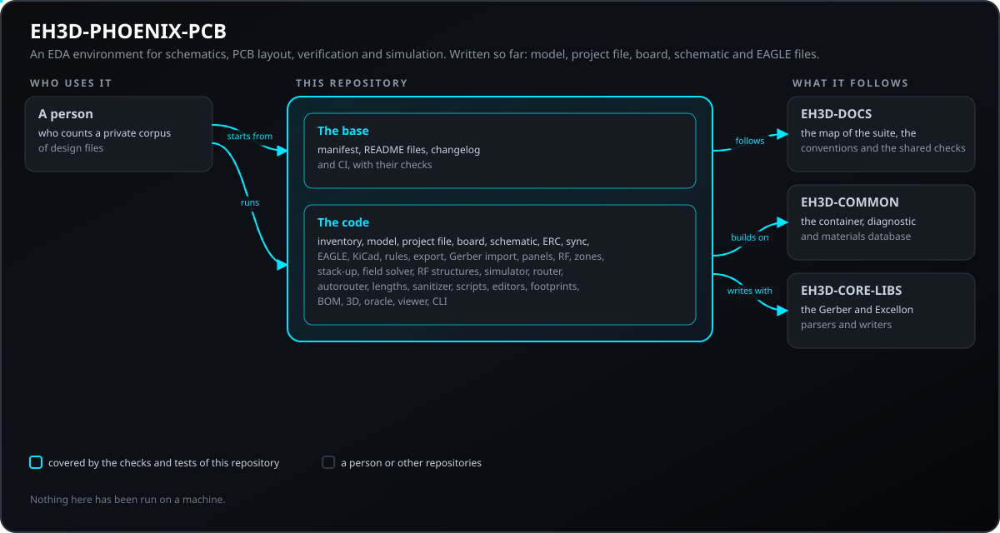
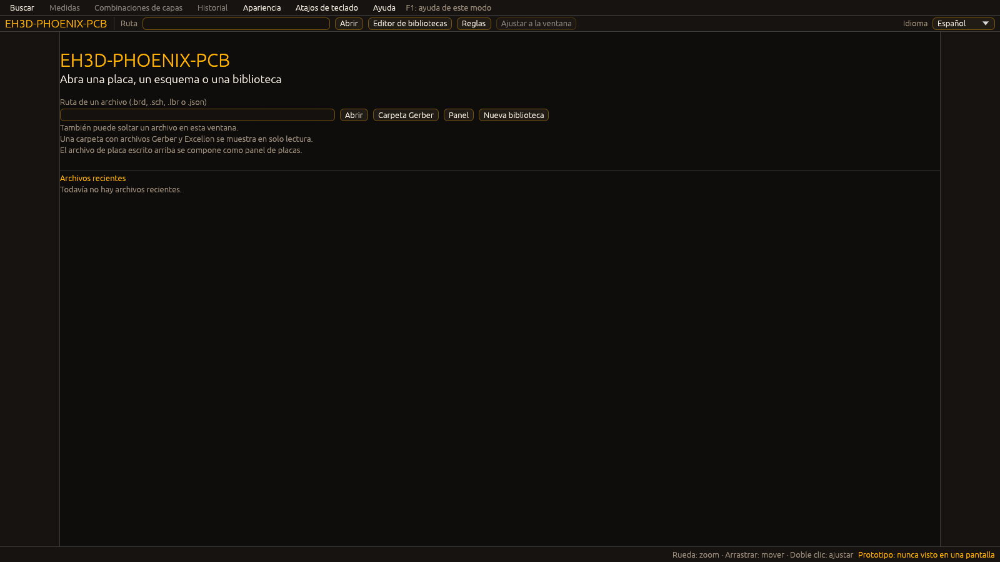
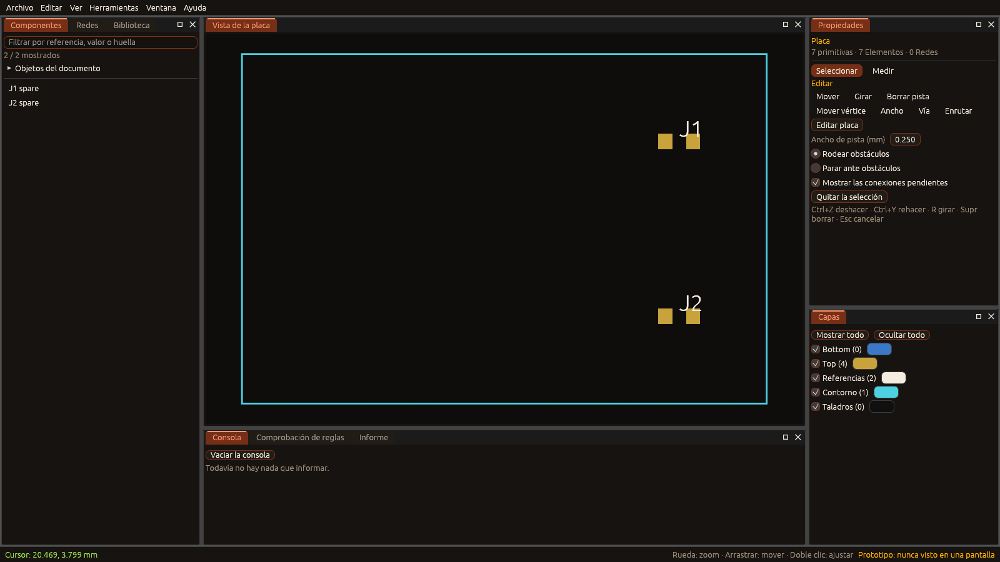
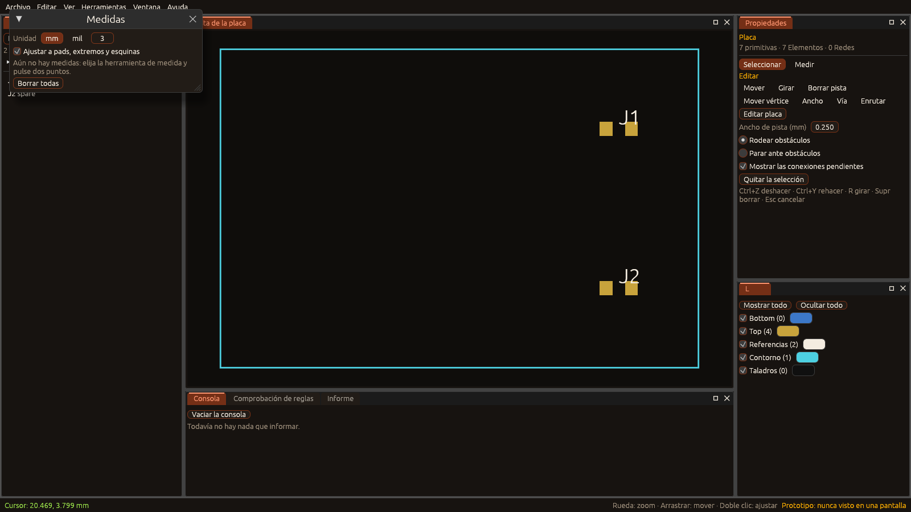
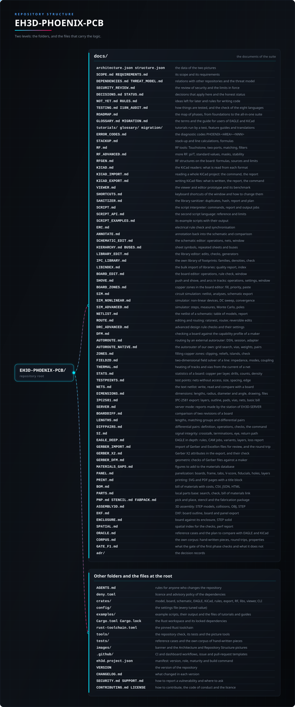

<p align="center">
  
</p>

#  EH3D-PHOENIX-PCB
<p align="center"><a href="README.md">🇺🇸 English</a> | 🇪🇸 <b>Español</b> | <a href="README_fra.md">🇫🇷 Français</a> | <a href="README_ita.md">🇮🇹 Italiano</a> | <a href="README_deu.md">🇩🇪 Deutsch</a> | <a href="README_zho.md">🇨🇳 中文</a> | <a href="README_jpn.md">🇯🇵 日本語</a> | <a href="README_por.md">🇵🇹 Português</a></p>

### EH3D-PHOENIX-PCB: planificado como un entorno EDA con captura de esquemas, diseño de PCB, herramientas de verificación, simulación de circuitos y módulos especializados para fuentes conmutadas y RF. Hasta ahora solo está escrito el inventario del corpus.

<p align="center">
  
  
  
  
  
  
</p>

---

**Comprobación de honestidad - lo que se ejecuta hoy:** un espacio de trabajo de Rust cuyo comando `phoenix inventory` cuenta los archivos de diseño de una carpeta privada sin mostrar ningún nombre ni valor: archivos por extensión, tipo y versión declarada, y una huella del contenido. Tiene 5541 pruebas propias y pasan en un ordenador. Solo se ha ejecutado con carpetas creadas por sus propias pruebas, nunca con archivos de diseño reales. También tiene los cimientos de un modelo de diseño (valores enteros en nanómetros y micrograos con rango comprobado, ids de objeto y JSON canónico), el archivo de proyecto `.phoenixproj` (manifiesto, dominios, migraciones) y un modelo de placa con operaciones reversibles (capas, redes, componentes, pistas, vías, zonas), todo probado solo con datos generados. La biblioteca de placa también halla qué cobre toca a cuál y comprueba tamaños y holguras con un archivo de reglas; una quinta biblioteca lee librerías, placas y esquemáticos EAGLE XML en un resumen y reescribe el árbol XML de forma idéntica. Todo se ha probado solo con archivos generados o hechos a mano. También existen un modelo de esquemático y su comprobación de coherencia con la placa. Los lectores de otros formatos (EAGLE, KiCad, Gerber, DXF) y los editores que se describen más abajo son prototipos, las reglas cubren solo parte de las comprobaciones previstas y la mayor parte de la función de EDA sigue planificada. El modelo de la placa también guarda texto y trazos de serigrafía (con una fuente de trazos incorporada) que usan la comprobación de reglas y la exportación Gerber, y el esquemático puede dibujarse en hojas con piezas colocadas y cables que se comparan con la lista de redes y con la placa; una placa puede escribirse como fichero XML de EAGLE y leerse de nuevo, lo cual solo se ha comprobado con ficheros escritos por este código y nunca se ha abierto en EAGLE; el contrato para pares de ficheros binarios de EAGLE y su XML está escrito; se leen las bibliotecas y las placas binarias de EAGLE de las versiones 3 a 5 (solo lectura), no los esquemáticos binarios. Una calculadora de apilado y líneas de transmisión (`phoenix stackup`: impedancia, permitividad efectiva, pérdidas, retardo y ancho de pista de microstrip, stripline, guía coplanar y pares acoplados con fórmulas publicadas) es un prototipo, nunca comparado con un simulador de campo ni con una medición. Con la base de materiales de EH3D-COMMON (`phoenix materials`, `phoenix stackup --material ID`), la Dk y el Df de una capa salen de los puntos que publica una hoja de datos, nunca extrapolados; ninguno de estos valores se ha comparado con la medición de una placa. Una biblioteca de conectividad y reglas (`eh3d-phoenix-rules`) lee los límites de un fichero de reglas o de las reglas de diseño de una placa EAGLE, comprueba una placa en un orden fijo (ancho, vía, taladro, anillo, separación, borde, separación entre taladros, máscara de soldadura, zonas, serigrafía), encuentra cortocircuitos y redes sin rutar y compara las redes de una placa con las de un esquema, y los comandos `phoenix check` y `phoenix connectivity` imprimen el informe con los hallazgos confirmados y los no concluyentes por separado; solo se ha probado con placas hechas a mano y nunca se ha comparado con la herramienta de referencia. Otras comprobaciones de reglas de diseño (`phoenix check --advanced`: anillo anular, distancia al borde de la placa, trampas de ácido, separación según la tensión, islas de cobre, pistas muertas, vías duplicadas, pads sin red y piezas fuera del contorno, con los límites y los niveles en `config/drc_advanced.cfg`) también son un prototipo, probado solo con placas hechas a mano y nunca comparado con las reglas de un fabricante ni con otra herramienta; las cifras de la tabla de separación no están verificadas con la norma. La exportación de fabricación (`phoenix export`) genera archivos Gerber X2 de cada capa, archivos de taladro Excellon metalizados y sin metalizar, un archivo de coordenadas de montaje y una lista de materiales con perfiles leídos de un archivo JSON, un manifiesto con sumas SHA-256 y una comprobación que relee los archivos y los compara con la placa; es un prototipo cuyos archivos solo han sido leídos por los analizadores de este repositorio, nunca abiertos en un visor independiente ni por un fabricante. Sobre ella, `phoenix pnp`, `phoenix stencil` y `phoenix fabpack` generan archivos de coordenadas de montaje, las aperturas de una plantilla de pasta de soldadura y un paquete zip determinista con un manifiesto; son prototipos cuyos archivos nunca se han cargado en una máquina, ni se ha fabricado con ellos una plantilla, ni se han enviado a un fabricante. Un conjunto de herramientas de RF (`eh3d-phoenix-rf`, comando `phoenix rf`) lee y escribe archivos Touchstone, convierte parámetros S, Z, Y y ABCD, calcula ROE, pérdidas, retardo de grupo y estabilidad, diseña redes en L, adaptadores de stub simple y secciones de cuarto de onda para impedancias complejas, da las coordenadas de la carta de Smith y diseña filtros en escalera de Butterworth, Chebyshev y Bessel con componentes ideales; es un prototipo comprobado solo con valores de libro, nunca comparado con un analizador de redes, un simulador de campo ni otro programa de RF. Un lector de KiCad (`eh3d-phoenix-kicad`, comando `phoenix kicad-read`) lee las bibliotecas de símbolos, las huellas, los esquemas con sus hojas, las placas y los archivos de proyecto de KiCad 6 a 9 hacia el mismo modelo que los archivos de EAGLE, con un informe de importación y un nivel de fidelidad; es un prototipo probado solo con archivos escritos a mano para sus pruebas, nunca comparado con KiCad ni ejecutado sobre una colección pública de diseños. Un saneador de bibliotecas (`eh3d-phoenix-sanitizer`, comando `phoenix sanitize`) lee una carpeta de bibliotecas EAGLE antiguas e informa de las huellas, los símbolos y los dispositivos duplicados o casi duplicados, con un hash geométrico canónico, una puntuación frente a un umbral, un informe en HTML y en JSON y un plan de biblioteca maestra; solo analiza, nunca reescribe una biblioteca ni aplica el plan, y es un prototipo probado solo con bibliotecas hechas por sus propias pruebas, nunca con bibliotecas reales. Una comprobación eléctrica (`eh3d-phoenix-erc`, comando `phoenix erc`) juzga un esquema: pines que no están en ninguna red, redes con un solo pin, tipos de pin que una matriz de un fichero de ajustes no permite juntos, entradas sin emisor, alimentaciones sin fuente, nombres de red parecidos, referencias repetidas, valores vacíos, piezas sin huella, cables sueltos, redes que nada maneja, pines de alimentación de chips sin condensador de desacoplo, nombres de red que pueden ser erratas y etiquetas que no tocan nada, con los hallazgos confirmados y los no concluyentes por separado; una sincronización (`eh3d-phoenix-sync`, comando `phoenix sync`) compara un esquema y una placa por la identidad de sus piezas y hace los cambios de la transferencia a la placa, o de la anotación de vuelta al esquema, como un paquete que se prueba antes en seco y que se puede deshacer y rehacer, con un plan de la anotación de vuelta que da a cada cambio un estado (aplicable, conflicto o ignorado) y un código de confirmación (`phoenix annotate`) y una comparación de los dos documentos (`phoenix sync --diff`); el fichero de reglas del segundo formato guarda además clases de red con límites propios para pistas y vías. Todo es un prototipo probado solo con esquemas y placas hechos a mano y por las pruebas, nunca comparado con la herramienta de referencia, y el editor de esquemas (el comando `phoenix schedit` y un modo de edición de la ventana) es también un prototipo, probado solo sin pantalla: operaciones que se pueden deshacer, una lista de redes que sigue al dibujo, la comprobación de reglas tras cada cambio y la transferencia a la placa. Un simulador de circuitos (`eh3d-phoenix-sim`, comando `phoenix sim`) lee y escribe netlists al estilo SPICE, traduce un esquema a una netlist y resuelve circuitos lineales, con diodos (con resistencia serie, capacidad de unión y ruptura), con transistores bipolares y MOS, con interruptores controlados por tensión y con macromodelos de amplificador operacional por un análisis nodal modificado propio (punto de operación en continua y barrido en continua de una fuente, barridos de alterna con retardo de grupo, ruido y análisis transitorio con un paso que se detiene en los flancos de las fuentes), con una comprobación frente a los filtros en escalera de las herramientas RF; lee también las líneas `.op`, `.dc`, `.tran` y `.ac` de una netlist y el `.include` de ficheros de la misma carpeta; es un prototipo probado con valores de libro y soluciones cerradas, nunca comparado con SPICE ni con una medición, y sus modelos de dispositivos son sencillos. También hace barridos de un parámetro, medidas sobre los resultados, Monte Carlo sobre tolerancias con semilla fija, ruido, y polos y ceros a partir de un ajuste de la respuesta AC; es también un prototipo, comprobado con casos de solución cerrada y nunca comparado con SPICE. Una biblioteca para la lógica de edición y enrutado (`eh3d-phoenix-route`, comandos `phoenix route` y `phoenix ratsnest`) lista las conexiones que faltan por enrutar y enruta entre dos elementos de una red con tramos a 0, 45 y 90 grados, deteniéndose ante un obstáculo o rodeándolo, con el ancho de la clase de red y vías dimensionadas por las reglas, y sus ediciones son operaciones reversibles que informan de lo que añaden a la comprobación de reglas; es un prototipo probado con placas hechas a mano y por las pruebas, sin arcos ni zonas de cobre; la ventana que edita con él (`phoenix view`) no se ha visto nunca en una pantalla. El enrutado con un autorruteador externo va por archivos (`phoenix autoroute`): la placa se escribe como un archivo Specctra DSN, una sesión de Specctra se lee como un plan cuyas rutas se comprueban con las reglas y se aplican todas o ninguna, y un adaptador que lanza un programa viene apagado y no lanza nada sin un interruptor en un archivo de ajustes y una opción en la línea de órdenes; es un prototipo probado solo con sesiones hechas a mano, nunca con un autorruteador real. Un autorruteador sencillo propio (`phoenix autoroute native`) rutea las conexiones abiertas con una búsqueda sobre una rejilla, capa por capa, con vías y con deshacer y reenrutar dentro de límites que cuentan nodos, y su plan se comprueba con las reglas y nunca añade un error de reglas; es un prototipo probado en placas pequeñas hechas a mano y por las pruebas, y el botón de la ventana nunca se ha visto en una pantalla. Un intérprete de scripts (`eh3d-phoenix-script`, comandos `phoenix script run`, `phoenix script report` y `phoenix cam-import`) lee archivos de script del lenguaje de órdenes del flujo de trabajo anterior, ejecuta `WIRE`, `VIA`, `MOVE`, `CHANGE`, `DELETE`, `DRC` y las demás órdenes que tienen equivalente como operaciones reversibles de la placa, todo o nada y con un deshacer que devuelve el original byte a byte, lista cada orden de cada script como equivalente, adaptada o pendiente con su causa y lee un trabajo de salida como perfil de exportación; se construyó a partir de la descripción pública del lenguaje, es un prototipo probado solo con scripts escritos para sus pruebas y nunca se ha comparado con la herramienta original ni ejecutado con los scripts propios del autor. Un segundo lenguaje de scripts (`phoenix-script/2`: variables, bucles acotados, consultas y ediciones de una placa, un esquema o una biblioteca como un solo paso reversible, en un entorno aislado con límites; `phoenix script check`, `list` y `help`) es un prototipo probado solo con documentos hechos a mano. Un generador de estructuras de RF (`eh3d-phoenix-rfgen`, comando `phoenix rfgen`) dibuja a partir del apilado y la frecuencia líneas de microtira, codos con chaflán y curvos, transiciones de ancho, stubs, redes de adaptación, filtros paso bajo de impedancias escalonadas y paso banda de líneas acopladas, un divisor de Wilkinson, un acoplador de ramas, antenas de parche y dipolo y una transición SMA con vallado de vías, con fórmulas publicadas, y los pone en la placa como operaciones reversibles, todo o nada, con un informe de las dimensiones, las fórmulas usadas y la comprobación de reglas del resultado; es un prototipo, probado solo con valores de libros de texto y con placas hechas por las pruebas, y nunca se ha comparado con un simulador electromagnético ni con una medición. Un escritor de KiCad (`phoenix kicad-export`) escribe una placa, un esquema, huellas y símbolos como archivos de KiCad 8, con un informe de lo que el modelo no puede decir; es un prototipo cuyos archivos nunca se han abierto en KiCad. Los pares diferenciales (`phoenix pairs` y las operaciones `route_pair`, `tune_pair` y `fix_pair_gap` de `phoenix boardedit`) trazan las dos pistas de un par una junto a la otra, igualan sus longitudes con meandros, corrigen su separación y comprueban la separación, la simetría, el tramo sin acoplar, las longitudes, las vías, el ancho y, con un apilado, la impedancia; son un prototipo probado solo con placas hechas a mano y por las pruebas, y la herramienta de la ventana para ellos nunca se ha visto en una pantalla. El trazado con empuje (la operación `route_shove` de `phoenix boardedit`) aparta en paralelo las pistas de otras redes que una pista nueva estrecharía, dentro de una profundidad y un número de pistas fijados en un fichero, todo o nada y rechazado si dejara un error de reglas; con él vienen los arcos en las pistas (`route_arc`, `round_corners`) y los meandros en piezas a 45 grados; son un prototipo probado solo con placas hechas a mano y por las pruebas, y la herramienta de empuje de la ventana nunca se ha visto en una pantalla. La impresión (`phoenix print`, `eh3d-phoenix-print`) escribe las hojas de un esquema, el plano de montaje y las capas de una placa y un panel como SVG o como un PDF hecho a mano; es un prototipo cuyo PDF solo ha leído el comprobador de su propio crate y que nunca se ha abierto en un lector de PDF real. Las estimaciones de integridad de señal (`phoenix si`, `eh3d-phoenix-si`) dan la diafonía entre pistas paralelas, las reflexiones y terminaciones de las redes, un diagrama de ojo simplificado y el camino de retorno de las pistas a partir de fórmulas cerradas y del apilado; son prototipos cuasi estáticos probados solo con placas hechas por las pruebas, sin nada comparado con un solucionador de campo, un simulador o una medida. Un solucionador de campo bidimensional de la sección de una línea (`phoenix field2d`: impedancia, permitividad, inductancia y acoplamiento de un par, junto a las fórmulas cerradas), el calentamiento de pistas y vías según la corriente de su red (`phoenix thermal`) y las esquinas redondeadas del relleno de zonas son prototipos, comprobados solo con soluciones exactas y fórmulas cerradas, nunca con otro solucionador de campo ni con una medida. Las estadísticas de una placa (`phoenix stats`: tamaño, recuentos, el cobre de cada capa, taladros por diámetro, densidad y una comparación del cobre de las capas que se reflejan), los puntos de prueba de una placa y las redes a las que ninguna sonda llega (`phoenix testpoints`), la escritura y la lectura de archivos IPC-2581 (`phoenix ipc2581`: el archivo escrito es un subconjunto que no se ha comprobado con el esquema del estándar ni abierto en ningún visor; el lector acepta las revisiones A, B y C y se ha probado con 77 archivos de ejemplo), la lista de redes de texto de una placa y su comparación con un archivo de lista de redes (`phoenix nets`), la comparación de dos revisiones de una placa (`phoenix boarddiff`), el informe de una placa hecho por la estación de EH3D-SERVER (`phoenix server`, que también guarda una placa en el almacén de proyectos del servidor, nunca probado con un servidor en marcha) y la función X2 de Gerber `TestPad` para los puntos de prueba son prototipos, probados solo con placas hechas por las pruebas y sin compararlos con ninguna otra herramienta ni medida. Los perfiles de fabricantes (`phoenix check --dfm-profile pcbway-dru`, `phoenix export --profile jlcpcb-2l-cam`, `docs/FAB_PROFILES.md`) recogen los límites de sus reglas de diseño publicadas y los nombres, formatos y orden de ficheros de sus trabajos CAM; no están verificados con ningún fabricante.

---

> **Estado de seguridad (safety) y de seguridad informática:** este repositorio está en sus primeros pasos y no es un sistema de seguridad (safety). Nada de lo escrito aquí sustituye los límites, los enclavamientos y la parada de emergencia de la máquina y de su controlador.

## 📋 De un vistazo

| | |
|---|---|
| Versión | `0.1.7` |
| Madurez | Andamiaje |
| Pruebas | 5541 |
| Pila tecnológica | Rust, Python 3.10+ |
| En hardware real | Aún no se ha ejecutado en hardware |

**Ir a:** [Resumen](#-resumen) · [Arquitectura](#-arquitectura) · [Inicio rápido](#-inicio-rápido) · [Pruebas](#-pruebas) · [Estructura del repositorio](#-estructura-del-repositorio) · [Proyectos relacionados](#-proyectos-relacionados)

## 🚦 Estado del proyecto

Cada línea es una parte de este repositorio y la luz dice hasta dónde llega hoy. Se escribe con lo que el repositorio puede demostrar (pruebas, compilaciones, ejecuciones), no con lo previsto.

🟢 Hecho y verificado · 🟡 Funciona, con límites conocidos · 🟠 Hecho a medias o sin verificar · 🔴 Sin hacer o sin funcionar

| Área | Estado | Qué significa aquí |
|---|---|---|
| Comprobaciones del repositorio | 🟡 | La comprobación del repositorio, la de las imágenes y las 70 pruebas de la base se ejecutan en el CI y pasan. |
| Pruebas | 🟡 | Las 5541 pruebas del código Rust y las 70 de la base pasan en un ordenador. Usan solo carpetas creadas por las propias pruebas; ninguna se ha ejecutado con archivos de diseño reales. |
| Hardware real | 🟠 | No se ha ejecutado en ninguna máquina ni placa: nada de aquí se ha probado en hardware. |
| Función planificada | 🟠 | Escrito: el inventario redactado de un corpus, los cimientos del modelo (unidades, ids, JSON canónico), el archivo de proyecto `.phoenixproj`, el modelo de placa con deshacer y rehacer, su conectividad y una primera comprobación de reglas, y un lector de resumen de EAGLE XML. Sin empezar: el lector de los esquemáticos binarios de EAGLE, los escritores de formatos distintos de EAGLE, KiCad, Gerber, Excellon y DXF, la mayor parte de las reglas previstas, los editores y el visor definitivos (los que existen son prototipos, descritos más abajo), la comparación del simulador con SPICE y todo lo demás planificado. El modelo de la placa también guarda texto y trazos de serigrafía (con una fuente de trazos incorporada) que usan la comprobación de reglas y la exportación Gerber, y el esquemático puede dibujarse en hojas con piezas colocadas y cables que se comparan con la lista de redes y con la placa; una placa puede escribirse como fichero XML de EAGLE y leerse de nuevo, lo cual solo se ha comprobado con ficheros escritos por este código y nunca se ha abierto en EAGLE; el contrato para pares de ficheros binarios de EAGLE y su XML está escrito; se leen las bibliotecas y las placas binarias de EAGLE de las versiones 3 a 5 (solo lectura), no los esquemáticos binarios. Una calculadora de apilado y líneas de transmisión (`phoenix stackup`: impedancia, permitividad efectiva, pérdidas, retardo y ancho de pista de microstrip, stripline, guía coplanar y pares acoplados con fórmulas publicadas) es un prototipo, nunca comparado con un simulador de campo ni con una medición. Con la base de materiales de EH3D-COMMON (`phoenix materials`, `phoenix stackup --material ID`), la Dk y el Df de una capa salen de los puntos que publica una hoja de datos, nunca extrapolados; ninguno de estos valores se ha comparado con la medición de una placa. Un conjunto de herramientas de RF (`phoenix rf`: archivos Touchstone, parámetros de dos puertos, adaptación, filtros en escalera ideales y, como estimaciones, redes pi y T, valores normalizados, máscaras y círculos de estabilidad) es un prototipo, comprobado solo con valores de libro y nunca comparado con una medida. Un lector de KiCad (`phoenix kicad-read`: símbolos, huellas, esquemas con hojas, placas y el archivo de proyecto) es un prototipo, probado solo con archivos escritos a mano. Un saneador de bibliotecas (`phoenix sanitize`: inventario de una carpeta de bibliotecas EAGLE, hash geométrico, coincidencia aproximada con umbral, grupos de duplicados, informe HTML y JSON y un plan de biblioteca maestra que nunca se aplica) es un prototipo, probado solo con bibliotecas hechas por sus pruebas. Una comprobación eléctrica (`phoenix erc`) y la sincronización de un esquema y una placa (`phoenix sync`: transferencia a la placa y anotación de vuelta, como un paquete que se puede deshacer) son prototipos, probados solo con esquemas y placas hechos a mano. Un simulador de circuitos propio (`phoenix sim`: netlists al estilo SPICE, la netlist de un esquema y análisis de continua, de alterna y transitorio de circuitos lineales y con diodos) es un prototipo, comprobado solo con valores de libro y nunca comparado con SPICE. La lógica de edición y enrutado (`phoenix route`, `phoenix ratsnest`: las conexiones pendientes, un enrutador de tramos a 0, 45 y 90 grados y ediciones reversibles con la comprobación de reglas en vivo) es un prototipo, probado solo con placas hechas a mano y por las pruebas. Un intérprete de scripts (`phoenix script run`, `phoenix script report`, `phoenix cam-import`: scripts del lenguaje de órdenes del flujo de trabajo anterior ejecutados como operaciones reversibles de la placa, todo o nada, un informe de compatibilidad por orden y por script, y trabajos de salida leídos como perfil de exportación) es un prototipo, construido a partir de la descripción pública del lenguaje y probado solo con scripts escritos para sus pruebas. Un segundo lenguaje de scripts (`phoenix-script/2`: variables, bucles acotados, consultas y ediciones de una placa, un esquema o una biblioteca como un solo paso reversible, en un entorno aislado con límites; `phoenix script check`, `list` y `help`) es un prototipo probado solo con documentos hechos a mano. Un generador de estructuras de RF (`phoenix rfgen`: líneas de microtira, codos, stubs, redes de adaptación, filtros, un divisor de Wilkinson, un acoplador de ramas, antenas de parche y dipolo y una transición SMA con vallado de vías, dibujados a partir del apilado y la frecuencia como operaciones reversibles de la placa con un informe de las fórmulas y la comprobación de reglas) es un prototipo, comprobado solo con valores de libros de texto y nunca comparado con un simulador electromagnético ni con una medición. Una lista de materiales con costes (`phoenix bom`: piezas agrupadas por valor, huella y fabricante, precios por tramo de cantidad de un fichero local, el coste por placa y por lote, y una estimación del coste de las placas con tarifas de ejemplo, y la importación de la lista de EAGLE o de KiCad con rangos de referencias como R1-R5) y un montaje 3D de la placa con los modelos de sus componentes (`phoenix assembly3d`: un modelo por huella a partir de una tabla, la caja que envuelve cada sólido STEP, colisiones y altura comprobadas sobre cajas, y una exportación simplificada a OBJ y STEP) son prototipos, probados solo con placas y ficheros hechos por las pruebas; las tarifas son un ejemplo y no una oferta, ningún programa de CAD ha abierto los ficheros exportados, y la ventana 3D que dibuja la escena es un prototipo que nunca se ha visto en una pantalla. Un conjunto de casos de referencia (`phoenix oracle`) comprueba los cálculos con valores publicados, su fuente y su tolerancia; no es una comparación con EAGLE, KiCad, un resolvedor de campo ni una medición, y ningún estado de arriba cambia por ello. Un corpus propio (`phoenix corpus`) de placas, esquemas, bibliotecas y ficheros de fabricación pequeños escritos a mano, con los números calculados a mano, ficheros que deben rechazarse, idas y vueltas entre formatos y propiedades sobre placas generadas, es un prototipo; no contiene ficheros de ningún fabricante ni de ningún usuario y no es una comparación con EAGLE, KiCad ni un programa de CAM. Un solucionador de campo bidimensional de la sección de una línea (`phoenix field2d`: impedancia, permitividad, inductancia y acoplamiento de un par, junto a las fórmulas cerradas), el calentamiento de pistas y vías según la corriente de su red (`phoenix thermal`) y las esquinas redondeadas del relleno de zonas son prototipos, comprobados solo con soluciones exactas y fórmulas cerradas, nunca con otro solucionador de campo ni con una medida. |
| Ventana | 🟠 | El visor y editor de placas y esquemas (`phoenix view`, egui, tras la característica `gui`) está escrito y su lógica está probada: una placa se edita con deshacer y rehacer y con los hallazgos de las reglas de cada edición, un esquema se comprueba, se sincroniza con una placa y se edita (colocar, mover, girar, reflejar, borrar, copiar y pegar, cables, etiquetas, puertos de alimentación y nombres de bus, con la comprobación de reglas tras cada cambio), y nunca se guarda nada sobre el archivo leído; pero la ventana no se ha visto nunca en una pantalla: el dibujo, el ratón y la fluidez en pantalla no están comprobados. La misma ventana tiene un modo de bibliotecas que edita los símbolos, huellas y dispositivos de las bibliotecas EAGLE (`phoenix libedit`, `phoenix footprint`, `docs/LIBRARY_EDIT.md`) con deshacer, una comprobación de la biblioteca y generadores de huellas; tampoco se ha visto nunca en una pantalla. Un modo de edición de placas (`phoenix boardedit`, `docs/BOARD_EDIT.md`) coloca componentes, traza pistas a 45 grados y vías, pega redes y ajusta longitudes con meandros, y las reglas de diseño comprueban cada operación; nunca se ha visto en una pantalla ni se ha usado con un ratón. Una ventana para los archivos Gerber y Excellon de una carpeta (`docs/VIEWER.md`: una capa por archivo, opacidad, medida y comparación con la placa) y una ventana 3D de la placa ensamblada (cámara orbital, un clic elige un componente, colisiones y alturas señaladas) son prototipos; ninguna se ha visto en una pantalla ni se ha usado con un ratón. El programa `phoenix` (el mismo de la línea de comandos) la abre con una pantalla de inicio cuando se inicia sin argumentos (abrir un archivo, una biblioteca nueva, archivos recientes, soltar un archivo) y, en Windows, sin ventana de consola. Las partes comunes de la ventana (búsqueda, medidas, combinaciones de capas, lista del historial, temas, escala y teclas que se pueden cambiar, ayuda y preferencias recordadas) también son prototipos y nunca se han visto en una pantalla. |
| Requisitos | 🟠 | 32 de 34 requisitos (el modo redactado, los cimientos del modelo, las operaciones reversibles, el archivo de proyecto, los códigos de diagnóstico, las calculadoras RF analíticas, las comprobaciones de conectividad y de reglas y la exportación de fabricación con su paquete, el visor y editor de placas y esquemas los lectores y escritores de KiCad, el saneador de bibliotecas, las comprobaciones y la sincronización del esquema el simulador de circuitos, la lógica de enrutado y el intérprete de scripts) están en prototipo, 2 solo están planificados y ninguno está validado. |

## 🎯 Resumen

* **Lo que existe:** un espacio de trabajo con una biblioteca que cuenta un corpus privado de archivos de diseño en modo redactado (solo recuentos, tipos, versiones declaradas y una huella, nunca un nombre ni un valor) y una línea de comandos, `phoenix inventory`. Mira los primeros bytes de un archivo y no lee diseños. Una segunda biblioteca guarda los cimientos del modelo de diseño: longitudes y ángulos como enteros con rango comprobado, ids de objeto (UUID v7) y JSON canónico. Una tercera biblioteca lee y escribe el proyecto `.phoenixproj` sobre el contenedor compartido de EH3D-COMMON: el manifiesto con sus dominios, enlaces y migraciones, los dominios que no entiende conservados intactos y la regla `must_understand`. Una cuarta biblioteca guarda el modelo de placa: capas, redes, huellas, componentes, pistas con líneas y arcos, vías y zonas unidas por ids estables, con operaciones reversibles y un historial de deshacer y rehacer. Cada fallo tiene un código estable `PHOENIX-<ÁREA>-<NNN>`. La biblioteca de placa también calcula las islas de cada red y comprueba anchos, taladros, anillos y holguras con un archivo de reglas en milímetros, separando lo confirmado de lo no concluyente. Una quinta biblioteca lee librerías, placas y esquemáticos EAGLE XML en un resumen, reescribe el árbol XML de forma idéntica y mide la tasa de lectura sobre copias de un corpus comprobadas con SHA-256, sin cambiar los originales; el comando `phoenix eagle-rate` lo ejecuta. Una sexta biblioteca escribe los archivos Gerber X2, Excellon y `.eh3dproj` 1.0.0 de una placa con EH3D-CORE-LIBS y EH3D-COMMON, los mismos bytes para la misma placa; los archivos solo se releen con los analizadores de la misma biblioteca. Una séptima biblioteca guarda el esquemático (símbolos, piezas y redes unidos por ids estables) y lo comprueba contra una placa: piezas sin componente y diferencias de designadores, valores, huellas y redes, con los códigos `PHOENIX-LINK-<NNN>`. Otra biblioteca, `eh3d-phoenix-rules`, deduce las redes del cobre (pads, pistas, vías y zonas unidas por la geometría con una tolerancia), las compara con las del esquemático y ejecuta las reglas de diseño en un orden fijo contra límites leídos de un fichero de reglas o de las reglas de diseño de una placa EAGLE, con los hallazgos confirmados y los no concluyentes en dos listas; los comandos `phoenix check` y `phoenix connectivity` imprimen su informe como texto en ocho idiomas o como JSON.

* **Planificado:** EH3D-PHOENIX-PCB pretende ser un entorno EDA con captura de esquemas, diseño de PCB, herramientas de verificación, simulación de circuitos y módulos especializados para fuentes conmutadas y RF. Se planea como un programa en Rust con ventana para el escritorio (un espacio de trabajo de crates de motor, una interfaz de línea de comandos y una aplicación) que funciona solo y puede usar el servidor para tareas de cálculo. Solo una parte existe hoy, como prototipos: véase el estado más arriba.
* **Proyecto de la suite, adjuntos y hojas de datos en la ventana:** *Archivo > Proyecto de la suite (.eh3d)* abre, guarda y guarda como conservando todas las ramas (tras una pregunta), importa una placa o un esquema de EAGLE guardando el original, toma un fichero de otra rama, extrae una rama y lista las ramas, con una barra que dice qué está desactualizado o firmado. El panel «Adjuntos» de la suite guarda en el proyecto las hojas de datos y otros ficheros; desde una pieza (`R5`, `U3`) del esquema o de la placa se abre su hoja de datos y se le liga un adjunto. Solo se ha probado con tests, nunca en una pantalla; los paquetes llevan la biblioteca de PDF (PDFium) con sus licencias.

## 🧩 Papel en EH3D

EH3D-PHOENIX-PCB es el proyecto principal de la familia PHOENIX de la EH3D Fabrication Suite; los demás repositorios de la familia se apoyan en él. Lo que hará, lo que todavía no hará, sus requisitos y sus relaciones con otros repositorios están escritos en la carpeta `docs/`.

## 🏛️ Arquitectura

<p align="center">
  
</p>

Cómo encajan las partes de este repositorio: quién lo usa, qué contiene y de qué depende. La imagen se dibuja desde `docs/architecture.json` y se comprueba contra el código.

## 🚀 Inicio rápido

Necesitas Python 3.10 o superior para las comprobaciones y una cadena de herramientas de Rust para el código.

```bash
cargo build --release
cargo test
cargo run -p eh3d-phoenix-cli -- inventory <folder>
python -I tools/ci_validate.py
python -I tools/make_architecture.py --check
python -I tools/make_structure.py --check --readmes
python -I -m unittest discover -s tools -p "test_*.py"
```

**Descargar y abrir la ventana.** El archivo de una versión (Windows de 64 y 32 bits, Linux y macOS) contiene un solo programa, `phoenix`: la línea de comandos y, si se inicia sin argumentos, la ventana del visor y editor (el programa aparte `phoenix-gui` de las versiones anteriores ya no existe). Haga doble clic en `phoenix` (`phoenix.exe` en Windows): abre una pantalla de inicio donde puede abrir una placa, un esquema o una biblioteca, elegir uno de los archivos recientes o soltar un archivo sobre la ventana; `phoenix <archivo>` abre un archivo directamente. En Windows no tiene ventana de consola, así que cuando no se abre el motivo se escribe en `last_error.txt`, en la carpeta de ajustes del usuario (`%APPDATA%\EH3D-PHOENIX-PCB` en Windows, `~/.config/eh3d-phoenix-pcb` en los demás sistemas). La pantalla de inicio y *Archivo > Abrir reciente* muestran una sola lista de archivos recientes, guardada en `%APPDATA%\EH3D\recent-phoenix-pcb.txt` (`~/.config/eh3d/` en los demás sistemas); `config/viewer.cfg` fija cuántos guarda. Una orden (`phoenix check board.brd`) trabaja en la consola como siempre; en Windows el terminal no espera al programa, así que un archivo por lotes que necesite el código de salida lo inicia con `start /wait`. La ventana es un prototipo que no se ha probado con el ratón (véase el estado más arriba). Para compilar el programa con la ventana: `cargo build --release -p eh3d-phoenix-cli --features gui`. `phoenix --shot FILE.png [--size WxH] [--theme dark|light|contrast] [--window NAME] [--wait N] [--open FILE]` hace una captura de la ventana y se cierra solo (así se hacen las imágenes del README); en ese modo no se leen ni se escriben las preferencias ni la lista de archivos recientes.

<p align="center">
  
  
  
</p>

**Los paneles de la ventana.** La ventana se organiza con el marco de paneles acoplables de la suite: paneles para la placa, las capas, las propiedades, los componentes, las redes, los problemas de las reglas, la consola, el informe y las tareas, que se pueden mover, poner en pestañas, flotar, plegar en un borde, maximizar, bloquear y recuperar desde el menú Ver, en tres espacios de trabajo por tarea (edición, revisión y compacto; no hay niveles de experiencia), bajo una barra de menús con Archivo, Edición, Ver, Herramientas, Ventana y Ayuda. La biblioteca, los archivos Gerber importados, la vista 3D y el panel de placas también son paneles: permanecen ocultos hasta que se abre lo que muestran y entonces se unen a la placa en lugar de taparla. La disposición se guarda en el archivo de preferencias (las líneas `dock.*`) y `phoenix --shot FILE.png --workspace edit|review|compact` toma una imagen de un espacio de trabajo. La ventana es un prototipo que no se ha probado con ratón.

**Programas de usuario de la herramienta de referencia.** `phoenix ulp check` lee un programa (un archivo `.ulp`) con límites y lista lo que está mal en su forma, `phoenix ulp report` dice qué usa y si una lista de nombres permitidos (`config/ulp_support.cfg`) lo cubre, y `phoenix ulp run` ejecuta uno: cálculo puro y recorridos de solo lectura sobre una placa y un esquema (`--board`, `--schematic`), con límites de pasos, memoria, anidamiento y salida en `config/ulp.cfg`, y con la misma salida cada vez. No lanza programas y no cambia nada del diseño; solo lee y escribe archivos en la única carpeta que nombran `file_dir` o `--dir` (ninguna por defecto) y responde a los diálogos sin ventana. Se ejecuta en el proceso de quien llama: el entorno aislado en un proceso aparte todavía no está escrito. Solo se ha probado con programas escritos para el proyecto (`examples/ulp/`), nunca con un programa de terceros ni comparado con la herramienta original; véase `docs/ULP.md`.

**Kit de arranque.** La carpeta `kit/`, publicada también con cada versión como `eh3d-phoenix-pcb-kit-<version>.zip` con su SHA-256, contiene bibliotecas (pasivos, semiconductores, circuitos genéricos, conectores y dos tipos de módulo con medidas orientativas), 12 placas de ejemplo sintéticas con sus esquemas, 20 programas de usuario con su salida esperada, ficheros de reglas y perfiles de salida. Todo se ha hecho para este proyecto y es GPL-3.0-or-later; nada se ha verificado con una hoja de datos ni con un fabricante. `phoenix kit list|info|copy` muestra y copia sus piezas; véase [docs/KIT.md](docs/KIT.md).

**Bibliotecas binarias.** `phoenix libedit`, la ventana de bibliotecas, la importación en lote (`phoenix libindex`) y `phoenix ipc compare` leen también las bibliotecas binarias de EAGLE de las versiones 3 a 5: huellas, símbolos y dispositivos con sus conexiones y atributos, y un informe de todo lo que no se ha leído tal cual. Al guardar se escribe una biblioteca XML; el formato binario nunca se escribe. El programa se ha ejecutado sobre una colección privada de 3779 bibliotecas binarias y se ha comparado con el XML guardado de dos de ellas; nada de lo que escribe se ha abierto en EAGLE; ver [docs/EAGLE_BINARY.md](docs/EAGLE_BINARY.md). Las placas binarias (`.brd`) se abren como las placas XML en la ventana, en un proyecto de la suite (se guarda el original) y en las órdenes, con un informe de lo que no se ha leído tal cual; `phoenix eagle-convert xml` las escribe en XML.

**Placas grandes.** La comprobación tras cada edición, las líneas de conexión pendiente, deshacer y rehacer y el autorruteador propio están hechos para seguir siendo rápidos cuando la placa crece, la comprobación tras una edición y la vista previa de un empuje juzgan solo la zona cambiada, y el autorruteador repasa sus rutas para gastar menos vías y luego hace sitio a las conexiones que quedan. Se ha medido solo con placas sintéticas que crean las pruebas, nunca con un diseño real; ver [docs/PERFORMANCE.md](docs/PERFORMANCE.md) y [docs/AUTOROUTE_NATIVE.md](docs/AUTOROUTE_NATIVE.md).

**Empujar y apartar.** Una pista trazada con empuje se hace sitio: las pistas de otras redes se apartan o rodean los obstáculos, las vías se mueven con las pistas que terminan en ellas y se respeta la separación de las clases de red; el resultado es un solo paso de deshacer y se rechaza si añadiría un error de reglas o cortaría una conexión. Solo se ha probado en placas creadas por las pruebas; véase [docs/SHOVE.md](docs/SHOVE.md).

**Comprobación de reglas.** Una vía cuenta en todas las capas de cobre que atraviesa, un arco se mide a lo largo de su curva (también los arcos del contorno de la placa), una clase de red puede pedir su propia separación y un fichero de reglas puede alejar el cobre y los taladros de los agujeros no metalizados y del borde de la placa. Estas comprobaciones solo se han probado en placas hechas por los tests; véase [docs/ERROR_CODES.md](docs/ERROR_CODES.md).

## 🧪 Pruebas

El código tiene 5541 pruebas (`cargo test`) y la base tiene 70 (`python -I -m unittest discover -s tools -p "test_*.py"`); todas pasan en un ordenador. El CI ejecuta la comprobación del repositorio, la de las imágenes, las pruebas de la base y, para el código Rust, la comprobación de formato, clippy con las advertencias como errores y las pruebas en Linux y Windows.

## 🏗️ Compilación y publicación

La versión vive en el fichero `VERSION` y en `eh3d.project.json`, y cada versión tiene su entrada en [CHANGELOG.md](CHANGELOG.md). `cargo build --release` compila la biblioteca y el programa `phoenix`; las versiones se publican en GitHub. Los archivos de una versión contienen `phoenix`, la línea de comandos y la ventana en un solo programa; `cargo build --release -p eh3d-phoenix-cli --features gui` lo compila con la ventana.

## 📂 Estructura del repositorio

<p align="center">
  
</p>

<details>
<summary>Versión en texto del árbol</summary>

```text
EH3D-PHOENIX-PCB/
├── docs/
│   ├── architecture.json structure.json         los datos de las dos imágenes
│   ├── SCOPE.md REQUIREMENTS.md                 su alcance y sus requisitos
│   ├── DEPENDENCIES.md THREAT_MODEL.md          relaciones con otros repositorios y modelo de amenazas
│   ├── SECURITY_REVIEW.md                       la revisión de seguridad y los límites vigentes
│   ├── DECISIONS.md STATUS.md                   decisiones que se aplican aquí y estado honesto
│   ├── NOT_YET.md RULES.md                      ideas para más adelante y reglas para escribir código
│   ├── TESTING.md I18N_AUDIT.md                 cómo se prueba, y la comprobación de los ocho idiomas
│   ├── ROADMAP.md                               el mapa de fases, de los cimientos a la suite todo en uno
│   ├── GLOSSARY.md MIGRATION.md                 los términos y la guía para quien viene de EAGLE o KiCad
│   ├── tutorials/ glossary/ migration/          tutoriales que ejecuta una prueba, guías de funciones y traducciones
│   ├── ERROR_CODES.md                           los códigos de diagnóstico PHOENIX-<ÁREA>-<NNN>
│   ├── STACKUP.md                               cálculos de apilado y líneas, fórmulas
│   ├── RF.md                                    herramientas de RF: Touchstone, bipuertos, adaptación, filtros
│   ├── RF_ADVANCED.md                           más RF: pi/T, valores estándar, máscaras, estabilidad
│   ├── RFGEN.md                                 estructuras de RF en la placa: fórmulas, fuentes y límites
│   ├── KICAD.md                                 los lectores de KiCad: qué se lee de cada formato
│   ├── KICAD_IMPORT.md                          leer un proyecto completo de KiCad: el comando, el informe
│   ├── KICAD_EXPORT.md                          escribir archivos de KiCad: qué se escribe, el informe, el comando
│   ├── VIEWER.md                                el prototipo de visor y editor y su prueba de rendimiento
│   ├── SHORTCUTS.md                             atajos de teclado de la ventana y cómo cambiarlos
│   ├── SANITIZER.md                             el saneador de bibliotecas: duplicados, hash, informe y plan
│   ├── SCRIPT.md                                el intérprete de scripts: órdenes, informe y trabajos de salida
│   ├── SCRIPT_API.md                            el segundo lenguaje de scripts: referencia y límites
│   ├── SCRIPT_EXAMPLES.md                       sus scripts de ejemplo con su salida
│   ├── ULP.md                                   programas de la herramienta de referencia: lector, informe, evaluador
│   ├── KIT.md                                   el kit de arranque y la orden kit
│   ├── ERC.md                                   comprobación eléctrica y sincronización
│   ├── ANNOTATE.md                              anotación de vuelta al esquema y comparación
│   ├── SCHEMATIC_EDIT.md                        el editor de esquemas: operaciones, redes, ventana
│   ├── HIERARCHY.md BUSES.md                    símbolos de hoja, hojas repetidas y buses
│   ├── LIBRARY_EDIT.md                          el editor de bibliotecas: ediciones, pruebas, generadores
│   ├── IPC_LIBRARY.md                           la biblioteca propia de huellas: familias, densidades, pruebas
│   ├── LIBINDEX.md                              la importación masiva de bibliotecas: informe de calidad, índice
│   ├── BOARD_EDIT.md                            el editor de placas: operaciones, reglas, ventana
│   ├── SHOVE.md                                 empuje de pistas y arcos en pistas: operaciones, ajustes, ventana
│   ├── BOARD_ZONES.md                           zonas de cobre en el editor de placas: relleno, prioridad, pegado
│   ├── SIM.md                                   simulación de circuitos: netlist, análisis, exportación del esquema
│   ├── SIM_NONLINEAR.md                         simulador: dispositivos no lineales, barrido en continua, convergencia
│   ├── SIM_ADVANCED.md                          simulador: barridos, medidas, Monte Carlo, polos
│   ├── NETLIST.md                               la netlist de un esquema: tabla de modelos, informe
│   ├── ROUTE.md                                 edición y enrutado: ratsnest, enrutador, ediciones reversibles
│   ├── DRC_ADVANCED.md                          comprobaciones avanzadas de reglas y sus ajustes
│   ├── DFM.md                                   comprobar una placa contra el perfil de capacidades de un fabricante
│   ├── AUTOROUTE.md                             enrutado con un autorruteador externo: DSN, sesión, adaptador
│   ├── AUTOROUTE_NATIVE.md                      el autorruteador propio: búsqueda en rejilla, vías, pesos, pares
│   ├── ZONES.md                                 relleno de zonas de cobre: recorte, alivios, islas, comprobación
│   ├── FIELD2D.md                               solucionador de campo bidimensional de una línea: impedancia, modos, acoplamiento
│   ├── THERMAL.md                               calentamiento de pistas y vías según la corriente de una red
│   ├── STATS.md                                 estadísticas de una placa: cobre por capa, taladros, recuentos, densidad
│   ├── TESTPOINTS.md                            puntos de prueba: redes sin acceso, tamaño, separación, borde
│   ├── NETS.md                                  la lista de redes de texto: escribir, leer y comparar con una placa
│   ├── DIMENSIONS.md                            cotas: longitudes, radio, diámetro y ángulo, dibujo, archivos
│   ├── IPC2581.md                               exportación IPC-2581: capas, contorno, pads, vías, redes, lista básica
│   ├── SERVER.md                                modo servidor: informes hechos por la estación de EH3D-SERVER
│   ├── BOARDDIFF.md                             comparación de dos revisiones de una placa
│   ├── LENGTHS.md                               longitudes, grupos de igualación y pares diferenciales
│   ├── DIFFPAIRS.md                             pares diferenciales: definición, operaciones, comprobaciones, el comando
│   ├── SI.md                                    integridad de señal: diafonía, terminaciones, ojo, camino de retorno
│   ├── EAGLE_BINARY.md                          bibliotecas y placas binarias EAGLE 3 a 5
│   ├── EAGLE_DEEP.md                            EAGLE a fondo: reglas, trabajos CAM, variantes, capas, informe de pérdida
│   ├── GERBER_IMPORT.md                         importación de ficheros Gerber y Excellon para revisión, e ida y vuelta
│   ├── GERBER_X2.md                             atributos Gerber X2 en la exportación, y su comprobación
│   ├── GERBER_DFM.md                            comprobaciones geométricas de Gerber frente a un fabricante
│   ├── MATERIALS_GAPS.md                        cifras que faltan en la base de materiales
│   ├── PANEL.md                                 panelización: placas, marco, pestañas, V-score, fiduciales, taladros, capas
│   ├── PRINT.md                                 impresión: páginas SVG y PDF con rótulo
│   ├── BOM.md                                   lista de materiales con costes, CSV, JSON, HTML
│   ├── PARTS.md                                 base local de piezas: búsqueda, comprobación, enlace a la lista
│   ├── PNP.md STENCIL.md FABPACK.md             pick and place, plantilla y el paquete de fabricación
│   ├── ASSEMBLY3D.md                            ensamblado 3D: modelos STEP, colisiones, OBJ, STEP
│   ├── DXF.md                                   DXF: contorno y exportación de placas y paneles
│   ├── ENCLOSURE.md                             placa frente a su carcasa, sólido STEP
│   ├── SPATIAL.md                               índice espacial de las comprobaciones, informe perf
│   ├── ORACLE.md                                casos de referencia y el plan para comparar con EAGLE y KiCad
│   ├── CORPUS.md                                el corpus propio: piezas escritas a mano, idas y vueltas, propiedades
│   ├── GATE_F1.md                               qué comprueba la puerta de la primera fase y qué no
│   └── adr/                                     los registros de decisiones
├── AGENTS.md                                    reglas para quien cambia el repositorio
├── deny.toml                                    política de licencias y avisos de las dependencias
├── crates/                                      inventario, modelo, proyecto, placa, esquemático, EAGLE, KiCad, reglas, ERC, sincronización, hub, exportación, importación Gerber, panel, apilado, RF, simulador, enrutador, zonas, longitudes, lista de materiales, ensamblado 3D, saneador, scripts, visor, comandos
├── config/                                      el fichero de ajustes (todo valor afinado)
├── examples/                                    scripts de ejemplo, su salida y los ficheros de tutoriales y guías
├── Cargo.toml Cargo.lock                        el espacio de trabajo de Rust y sus dependencias fijadas
├── rust-toolchain.toml                          la toolchain de Rust fijada
├── kit/                                         el kit de arranque: bibliotecas, ejemplos
├── tools/                                       la comprobación del repositorio, sus pruebas y las herramientas de las imágenes
├── tests/                                       casos de referencia y el corpus propio de piezas escritas a mano
├── images/                                      banner y las imágenes de Arquitectura y Estructura del repositorio
├── .github/                                     flujos de CI y del panel, plantillas de issues y pull requests
├── eh3d.project.json                            manifiesto: versión, rol, madurez y comando de compilación
├── VERSION                                      la versión del repositorio
├── CHANGELOG.md                                 qué cambió en cada versión
├── SECURITY.md SUPPORT.md                       cómo informar de una vulnerabilidad y dónde preguntar
└── CONTRIBUTING.md CODE_OF_CONDUCT.md LICENSE   cómo contribuir, el código de conducta y la licencia
```

</details>

## 🗺️ Hoja de ruta y límites conocidos

**Límites conocidos hoy**

* Código inicial: solo existen el inventario del corpus y los cimientos del modelo; el inventario solo se ha ejecutado con carpetas creadas por sus propias pruebas, nunca con archivos de diseño reales.
* No hay esquemático, ni lector ni escritor de archivos de diseño de otros programas, ni editor, ni reglas; el archivo de proyecto y el modelo de placa solo se han probado con datos generados, nunca con un diseño real.
* La pila final de la interfaz de usuario sigue abierta (hay una elección provisional en `docs/adr/`), y también la biblioteca de geometría (véase `docs/STATUS.md`).

**Siguiente**

* Esperar a que se acepten los contratos de los que depende este proyecto (véase `docs/DEPENDENCIES.md`), escribir después el modelo y los primeros lectores con pruebas y sustituir las filas de estado por resultados reales.

## 🌍 Idiomas

El README y los textos existen en inglés, español, francés, italiano, alemán, chino, japonés y portugués de Portugal.

## 🔗 Proyectos relacionados

* [EH3D-DOCS](https://github.com/JuanenRac/EH3D-DOCS): el mapa de la suite, su arquitectura, las convenciones y las comprobaciones compartidas
* [EH3D-COMMON](https://github.com/JuanenRac/EH3D-COMMON): se construye junto a este repositorio; el contenedor de proyecto compartido (`eh3d-container`) y el diagnóstico común (`eh3d-diagnostic`) que usa este proyecto
* Repositorios hermanos de PHOENIX: [EH3D-VALIDATION-LAB](https://github.com/JuanenRac/EH3D-VALIDATION-LAB) (corpus y oráculo de archivos dorados) y [EH3D-PHOENIX-CAD](https://github.com/JuanenRac/EH3D-PHOENIX-CAD) (lado mecánico), ambos en código inicial
* Relaciones planificadas, aún sin construir (EH3D-CORE-LIBS, EH3D-SERVER, EH3D-DESIGN-VERIFIER, EH3D-DESIGN-HISTORY, EH3D-PROJECT-PASSPORT, EH3D-COMPONENT-INTELLIGENCE, EH3D-MANUFACTURING-PROFILE, EH3D-THERMAL-LAB, EH3D-LAB-BRIDGE, EH3D-DESIGN-EXPLORER, EH3D-ISOCAM, EH3D-DRILLPRO, EH3D-ROUTEPRO, EH3D-SUITE-LAUNCHER, EH3D-HYDRA-BRIDGE): véase [docs/DEPENDENCIES.md](docs/DEPENDENCIES.md)

## 📚 Documentación

* [Las convenciones de la suite](https://github.com/JuanenRac/EH3D-DOCS/blob/main/docs/CONVENTIONS.md)
* [Registro de cambios](CHANGELOG.md)
* [Alcance, requisitos, dependencias, modelo de amenazas y decisiones](docs/SCOPE.md)
* [Tutoriales](docs/tutorials/es/README.md): nueve flujos con comandos que ejecuta una prueba, en ocho idiomas; `phoenix help` explica cada tema y comando en el propio programa
* [Guías de funciones](docs/tutorials/guides/es/README.md): once guías sobre las funciones más recientes (informes de revisión, lista de materiales, plantillas de panel, solucionador de campo, rellenos, aberturas, buses, autorruteador, selección, capturas de la ventana, límites de las comprobaciones), en ocho idiomas
* [Pruebas](docs/TESTING.md): qué se prueba y cómo, dónde están los ficheros de ejemplo y cómo añadir un caso; [los ocho idiomas](docs/I18N_AUDIT.md): qué se comprueba en cada texto y en cada página
* [Glosario](docs/glossary/es/GLOSSARY.md) y [guía de migración para quien viene de EAGLE o de KiCad](docs/migration/es/MIGRATION.md)

## 🤝 Contribuir y comunidad

* Antes de una pull request ejecuta `python -I tools/ci_validate.py` y las pruebas de la base: todo debe pasar. Consulta [CONTRIBUTING.md](CONTRIBUTING.md) y el [código de conducta](CODE_OF_CONDUCT.md).
* El README existe en ocho idiomas: un cambio en el texto se hace en los ocho archivos, y las dos imágenes se dibujan a partir de `docs/architecture.json` y `docs/structure.json` con `tools/make_architecture.py` y `tools/make_structure.py`.
* Informa de una vulnerabilidad en privado: [SECURITY.md](SECURITY.md). Preguntas, ideas e informes: electrohobby3d@gmail.com ([SUPPORT.md](SUPPORT.md)). La revisión de seguridad que el proyecto hizo por sí mismo (sin auditoría externa): [docs/SECURITY_REVIEW.md](docs/SECURITY_REVIEW.md).

## 👤 AUTOR

**JuanenRac (Electro Hobby 3D)** · electrohobby3d@gmail.com

## 📜 LICENCIA

Software: GPL-3.0-or-later. Véase [LICENSE](LICENSE). Los diseños de hardware de la suite usan CERN OHL-S.
